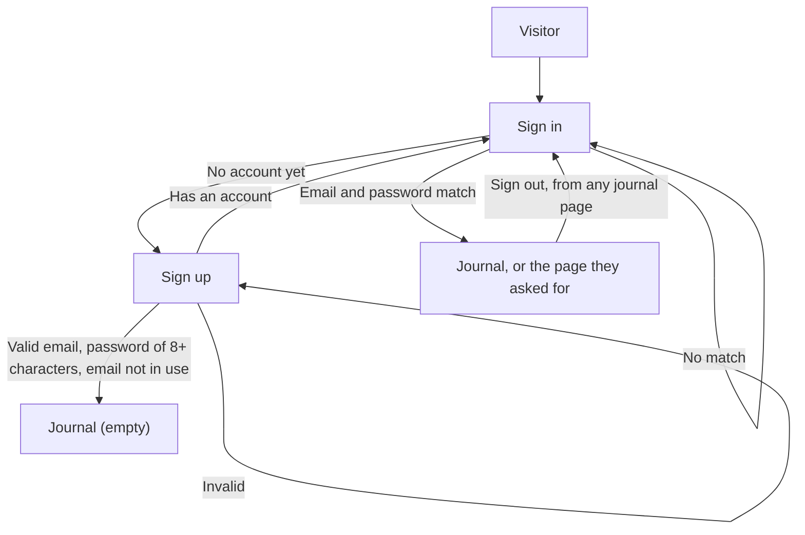
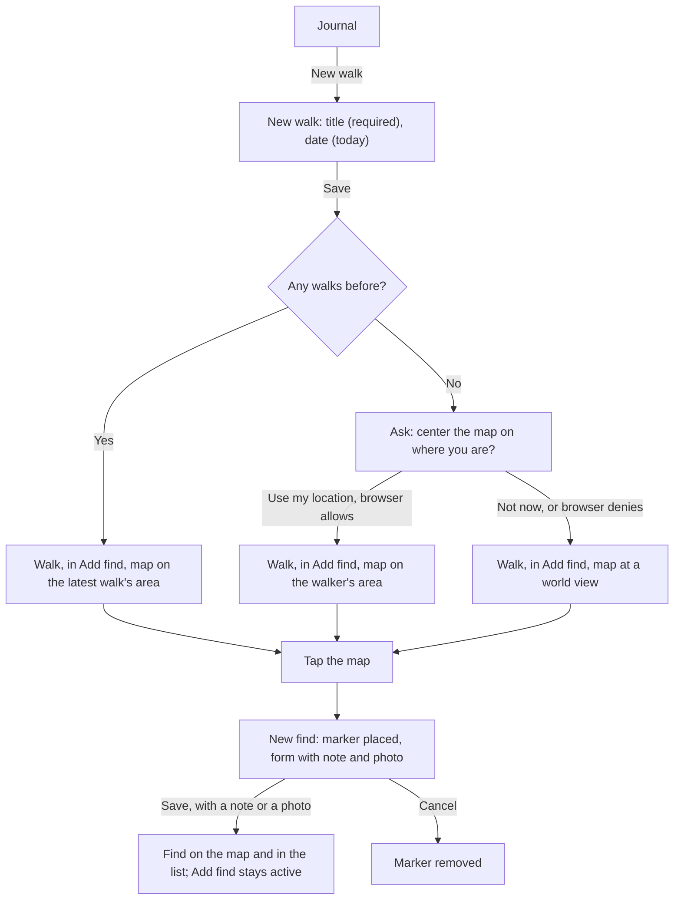
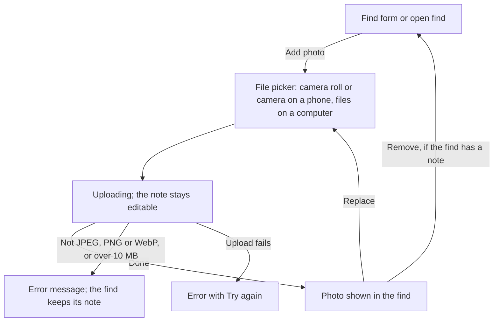
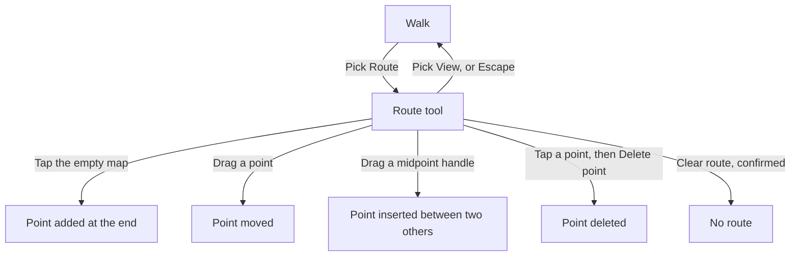
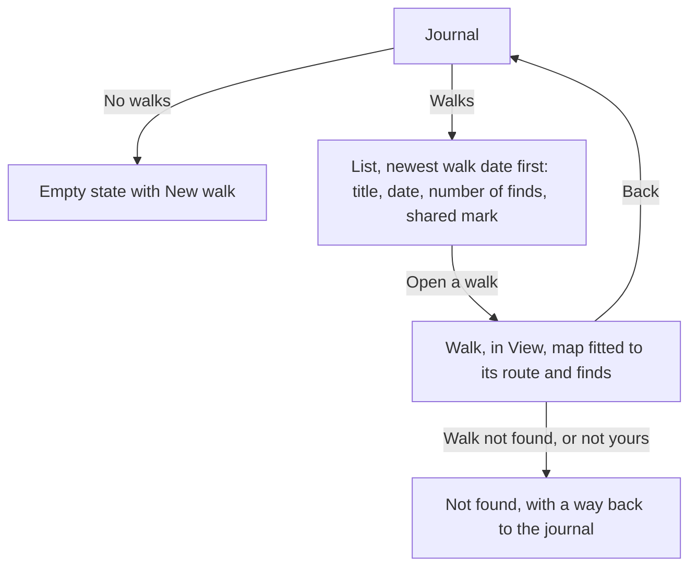
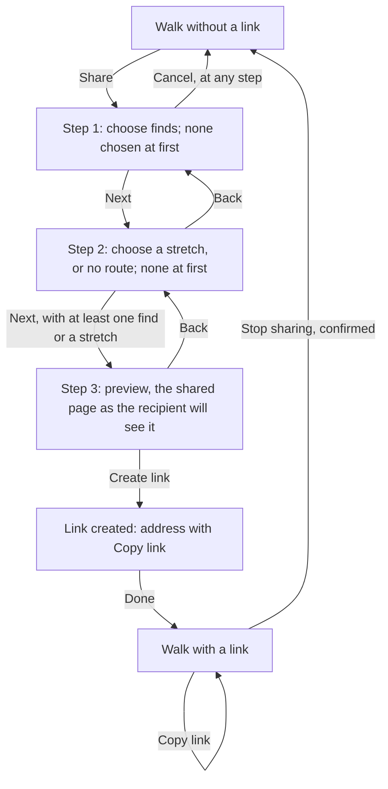
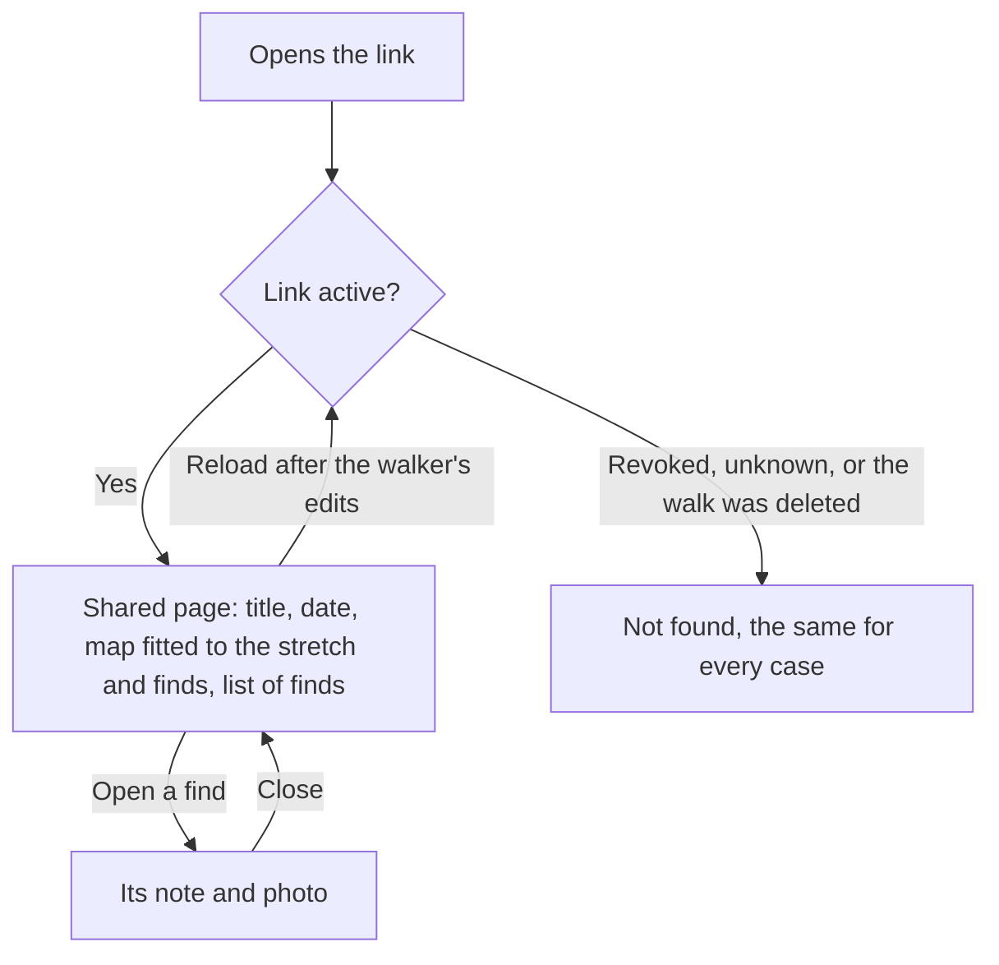

# Wandr — Flows

**Status:** Approved
**Date:** November 23, 2026
**Related:** [`02-mvp-scope.md`](./02-mvp-scope.md) · [`03-design-brief.md`](./03-design-brief.md)

Which screens the MVP has, how the walker and the recipient move through them, and what each screen shows in every state. It covers the Musts only. Layout, color and type live in the Design System and the screen designs; URLs, data and API live in the architecture.

---

## 1. Screens

| Screen | Area | Its job | Musts | States |
| --- | --- | --- | --- | --- |
| **Sign up** | Public | Create an account with email and password. | M1 | Ready, sending, error |
| **Sign in** | Public | Enter the journal. | M1 | Ready, sending, error |
| **Journal** | Journal | List my walks, newest first, and start a new one. | M5 | Loading, empty, list, error |
| **New walk** | Journal | Give a walk its title and date. | M2 | Ready, saving, error |
| **Walk** | Journal | See and edit one walk: its map, finds and route, and its link. | M2–M6 | Loading, view, adding a find, drawing the route, find open, shared, not found, error |
| **Share** | Journal | Choose finds and a stretch, preview, create the link. | M6 | Choosing finds, choosing a stretch, preview, creating, created, error |
| **Shared page** | Public | Show a link's selection, read-only. | M6 | Loading, the walk, find open, not found |
| **Not found** | Both | Answer for anything that doesn't exist or isn't yours, an unknown address included. | M1, M6 | — |
| **Error** | Both | Answer for a page that can't load, with a way to try again. It never shows technical detail. | — | — |

Every journal screen has a way back to the journal and a way to sign out (M1). A signed-out visitor who opens a journal page goes to **Sign in** and, once signed in, back to that page.

The **Walk** screen always lists its finds next to the map, each titled by the first line of its note (or "Photo" if it has none). The list is how finds are reached with the keyboard and how the walk reads at a glance.

## 2. The map editor

The rule that tells moving the map apart from editing it. It answers U1 in the design brief, and the route editor spike validates it on a real phone.

### Tools

The map on the **Walk** screen has three tools. The active tool decides what a tap does; only one is active at a time.

| Tool | Tap on the empty map | Tap on a find | Tap on a route point | Drag a find | Drag a route point | Drag a midpoint handle |
| --- | --- | --- | --- | --- | --- | --- |
| **View** | Nothing | Opens it | Nothing | Pans | Pans | — |
| **Add find** | Places a new find and opens its form | Opens it | Nothing | Moves it | Pans | — |
| **Route** | Adds a point at the end of the route | Nothing | Selects it, offering **Delete point** | Pans | Moves it | Inserts a point there |

### Rules for every tool

- Dragging the empty map, pinching and the scroll wheel always move the map. A drag edits only when it starts on something the active tool can move.
- A press that moves less than a small threshold counts as a tap, not a drag.
- Finds, points and handles have a touch area of at least 44 × 44 px, even when drawn smaller.
- Midpoint handles appear only in the **Route** tool, halfway between each pair of points.
- A tool stays active until another is picked; **Escape** returns to **View**. A walk opens in **View**; a new walk opens in **Add find**.

**If the spike finds** that dragging a point on a phone still clashes with panning, points and finds move only after a tap selects them. The tools stay.

## 3. Flows

### 3.1 Account (M1)

### 3.2 Walk and finds (M2)

- **Open a find:** tap its marker, or pick it from the list. It shows its note and photo, with **Edit** and **Delete**.
- **Move a find:** drag its marker in the **Add find** tool.
- **Edit the walk:** title and date are edited on the **Walk** screen.
- **Delete a find or the walk:** each asks for confirmation ([§4](#4-states-and-microcopy)). Deleting the walk returns to the journal.
- The location is used once, in the browser, to center the map. It is never stored.

### 3.3 Photo (M3)

A find always keeps a note or a photo: **Remove** is unavailable while the note is empty, with the hint "A find needs a note or a photo."

### 3.4 Route (M4)

The route is optional. With one point, it shows as a single point; with none, the walk is still complete.

### 3.5 Journal (M5)

### 3.6 Share (M6)

- **Choosing finds:** tap a marker or check it in the list.
- **Choosing a stretch:** tap a point to set the start and another to set the end. Each end also has **Previous point** and **Next point** buttons, for precision on a phone (U3) and for the keyboard.
- **The preview** is the shared page itself, under a banner saying it's a preview (U5).
- **A walk with a link** shows its address, **Copy link** and **Stop sharing** in place of **Share**. To show something different, the walker stops sharing and shares again, at a new address.

**While editing a walk with a link** (U4):

- Every find shows whether it's on the link, and the stretch is marked on the route.
- Dragging an end of the stretch shows the shared part change as it moves.
- A new find is marked as not on the link, and its form says so.
- Deleting a selected find, clearing the route or deleting the walk says, in its confirmation, what happens to the link.

### 3.7 Recipient (M6)

The shared page names no author and asks nothing of the recipient: no sign-up, no prompts. A quiet line above the title says what the page is, for a recipient who has never heard of Wandr (U6).

## 4. States and microcopy

Copy follows the voice in the [design brief](./03-design-brief.md#4-voice--tone). Loading states show the shape of the content without text. Before the app's JavaScript runs there is no content to take the shape of, so every address shows the Contour mark alone: 64 × 64 px, centered on the page background, named "Loading" for assistive technology. It stays until the page has something to show.

A tab's title is "{page} · Wandr", following the page in view; the home page is just "Wandr".

**Not found** for an unknown address and **Error** are the app's fallbacks: they answer for every page without its own state.

| Where | State | Copy |
| --- | --- | --- |
| Any page | No JavaScript | "Wandr needs JavaScript." · "Turn it on, then reload the page." |
| Any page | Error | "This page didn't load." · **Try again** · **Back to the start** · tab title "Page didn't load · Wandr" |
| Journal | Title | "Journal" |
| Journal | Empty | "Nothing here yet. Your first walk will live here." · **New walk** |
| Journal | Error | "Your walks didn't load." · **Try again** |
| Journal | List | Each walk: its title, then "{date} · {n} finds" ("Sat 21 Nov 2026 · 3 finds", "1 find"); a walk with a link adds "Shared" |
| Sign up | Email in use | "There's already an account with this email." |
| Sign up | Short password | "Use at least 8 characters." |
| Sign up | Has an account | "Have an account? **Sign in**" |
| Sign in | No match | "That email and password don't match." |
| Sign in | No account yet | "No account yet? **Sign up**" |
| New walk | No title | "Give your walk a name." |
| First walk | Location ask | "Center the map on where you are? Wandr only uses it to move the map, and doesn't save it." · **Use my location** · **Not now** |
| Find form | Title | "What did you find?" · the note's label: "Note" |
| Find form | Empty | **Save** unavailable · "Add a note or a photo." |
| Find form | Walk has a link | "New finds stay off your link." |
| Find form | No photo yet | **Add photo** · "JPEG, PNG or WebP, up to 10 MB." |
| Find | Uploading | "Uploading…" over the photo; the note stays editable |
| Find | Photo too big | "This photo is over 10 MB." |
| Find | Photo type | "Use a JPEG, PNG or WebP photo." |
| Find | Upload failed | "The photo didn't upload." · **Try again** |
| Any save | Failed | "Couldn't save. Your changes are still here." · **Try again** |
| Delete walk | Confirm | "Delete “{title}”? Its finds, photos and route go with it. This can't be undone." With a link, adds: "Its link will stop working." · **Delete walk** · **Cancel** |
| Delete find | Confirm | "Delete this find? This can't be undone." On the link, adds: "It will also disappear from your link." · **Delete find** · **Cancel** |
| Clear route | Confirm | "Clear the route? Its points can't be brought back." With a stretch on the link, adds: "Your link will show no route." · **Clear route** · **Cancel** |
| Share | Steps | "Step 1 of 3" · "Choose finds"; "Step 2 of 3" · "Choose a stretch"; "Step 3 of 3" · "Preview" |
| Share | Choosing finds | Each find: its title, then what it holds: "Note", "Photo" or "Note and photo" |
| Share | Stretch ends | **Start** and **End**, each with its place, "Point {n} of {total}", or "Not set" · **Previous point** · **Next point** |
| Share | No route | **No route** · "Share the finds only" |
| Share | Nothing chosen | **Next** unavailable · "Choose at least one find or a stretch." |
| Share | Preview banner | "Preview. Only you can see this." |
| Share | Created | "Your link is ready. It shows only what you chose." · **Copy link** → "Copied" |
| Walk | Has a link | "Shared" beside the walk's date |
| Walk | Stop sharing | "Stop sharing this walk? Anyone who opens the link will find nothing there. To share again, you'll create a new link." · **Stop sharing** · **Cancel** |
| Walk | Finds list | Each find: its title, then what it holds: "Note", "Photo" or "Note and photo"; with a link, "On your link" or "Not on your link" |
| Walk | Not on the link | "Not on your link" |
| Walk | On the link | "On your link" |
| Shared page | The walk | "A walk shared from Wandr" above the title |
| Not found | Unknown address | "This path isn't on the map." · "The address may be mistyped, or the page may have moved." · **Back to the start** · tab title "Page not found · Wandr" |
| Not found | Journal | "This walk isn't here." · **Back to your journal** |
| Not found | Shared page | "There's no walk here. The link may be mistyped, or no longer shared." |

## 5. Keyboard path (M7)

Every action works with the keyboard, with a visible focus, except placing and moving finds and points on the map.

- **Everywhere:** focus follows the reading order. **Escape** closes the open dialog or panel, or returns the map to **View**, and focus returns to what opened it. The map, when focused, pans with the arrow keys and zooms with **+** and **−**.
- **Sign up, Sign in, New walk:** fields in order; **Enter** submits.
- **Journal:** **New walk**, then each walk as a link.
- **Walk:** title and date, the tools, the list of finds (**Enter** opens a find, with its note, photo, **Delete** and on-link mark), **Share** or the link's **Copy link** and **Stop sharing**, **Clear route** and **Delete walk**. In the **Route** tool, the route's points take focus in order and **Delete** removes the focused one.
- **Share:** the finds as checkboxes; the stretch through its **Previous point** and **Next point** buttons and **No route**; then **Next**, **Back**, **Create link** and **Copy link**.
- **Shared page:** the list of finds; **Enter** opens one, **Escape** closes it.

## 6. The demo through the flows

The [demo in the scope](./02-mvp-scope.md#2-the-demo-this-scope-must-deliver), step by step.

| Demo step | Flow |
| --- | --- |
| Creates "Old houses of Laureles"; the map opens on their area | [3.2](#32-walk-and-finds-m2) |
| Drops a find on the blue house with a note and a photo | [3.2](#32-walk-and-finds-m2), [3.3](#33-photo-m3) |
| Draws the route with a handful of points | [3.4](#34-route-m4) |
| Opens the journal and the walk on a phone | [3.5](#35-journal-m5) |
| Chooses the blue house and the middle stretch, previews, creates the link | [3.6](#36-share-m6) |
| The friend opens the link and sees only that | [3.7](#37-recipient-m6) |
| Fixes a typo; the friend reloads and sees it | [3.2](#32-walk-and-finds-m2), [3.7](#37-recipient-m6) |
| Adds a new find; it isn't on the link | [3.2](#32-walk-and-finds-m2), [3.6](#36-share-m6) |
| Stops sharing; the page and the photo's address show "not found" | [3.6](#36-share-m6), [3.7](#37-recipient-m6) |
| Goes back through the journal with the keyboard, in dark mode | [§5](#5-keyboard-path-m7) |

## 7. To validate in the route editor spike

- The tools rule in [§2](#2-the-map-editor) works with a finger on a real phone, including drags that start on a point.
- Midpoint handles can be hit when points sit close together, at the zoom a neighborhood route is drawn at. There, a point and its handle sit about 30 px apart, so their 44 × 44 px touch areas overlap.
- **Previous point** and **Next point** make choosing a stretch's ends precise enough on a phone (U3).
