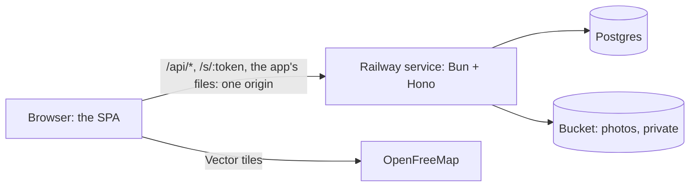
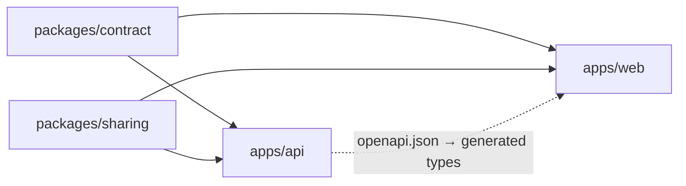

# Wandr — Architecture

**Status:** Approved
**Date:** November 24, 2026
**Related:** [`02-mvp-scope.md`](./02-mvp-scope.md) · [`03-design-brief.md`](./03-design-brief.md) · [`04-flows.md`](./04-flows.md) · [`knowledge/`](../knowledge/README.md)

How Wandr is built: its parts, its data, its API, and why each piece was chosen. The rules for writing the code that follows from these decisions live in [`knowledge/`](../knowledge/README.md).

---

## 1. Drivers

The architecture serves the three places where the [scope](./02-mvp-scope.md#4-where-the-engineering-effort-goes) puts the engineering effort, within 6 build days for one person.

- **The privacy promise holds in one place.** The backend checks the owner on every journal read and write, and every shared page reads through the public projection. Nothing else reaches the data.
- **One source per rule.** The API's schemas, the stretch rules and every query key are written once and used by everything that needs them, so the editor, the preview and the shared page can't drift apart.
- **The smallest thing that meets the scope.** Each piece is chosen against the Musts, not against what Wandr might become. Section [13](#13-revisit-when) lists what would change a choice.

## 2. Overview



- **One service, one origin.** Hono serves the API under `/api/*` and the SPA's built files, and answers every other path with `index.html`. The session cookie is first-party, there is no CORS, and every cache header is set in one place.
- **The browser talks to nothing else** but the map's tile provider. Photos, the shared page and the API all go through Hono.

## 3. Stack

| Area | Choice | Why |
| --- | --- | --- |
| App | A single-page app, **no service worker**, with a web app manifest | Offline use is out of scope, and a service worker's cache would be a second place a revoked link lives. The manifest makes "Add to Home Screen" look right and caches nothing. |
| Routing | TanStack Router, file-based, on Vite | Typed routes, loaders, one auth guard per layout, and code splitting per route, so a recipient never downloads the editor. TanStack Start would add a second backend beside Hono. |
| UI | React, shadcn/ui, Tailwind CSS | The [Design System](https://claude.ai/artifact/EdqUYYoSM61zcvvNMnocUi) themes shadcn/ui's components with its tokens. |
| Server state | TanStack Query behind resource hooks | Components only receive data; keys and fetches live in one layer ([`data-layer.md`](../knowledge/standards/data-layer.md)). |
| Forms | TanStack Form, validated by the contract's zod schemas | The client and the server validate with the same schema and show the same message. |
| Map | MapLibre GL JS through `react-map-gl/maplibre` | Meets the Design System's map requirements: our own style JSON, light and dark switched at runtime, DOM markers, keyboard, camera moves with no duration. Open source, no account. |
| Tiles | OpenFreeMap, with our own light and dark styles built from the `map-*` tokens | Free, with no key, no account and no cookies. Its OpenMapTiles schema is MapTiler's too, so switching providers is a URL change. |
| Backend | Hono with `@hono/zod-openapi` | Small, typed, and every route declares its schemas, which produce the OpenAPI document. |
| Runtime | Bun, in development and production | One runtime everywhere; `Bun.password` and `Bun.S3Client` need no extra dependency. |
| API contract | OpenAPI generated from zod schemas; the SPA's client generated from it | A reviewer sees every API change as a diff of `openapi.json`. |
| Database | Postgres, no PostGIS | Nothing in the MVP queries by space; map bounds are computed in the browser. |
| ORM | Drizzle, with generated SQL migrations committed | Every schema change is SQL a reviewer can read; nothing is pushed to a database without a migration. |
| Photos | `sharp` on the server; a private bucket | Location metadata is removed before anything is stored ([§8](#8-photos)). |
| Auth | Our own sessions, following Lucia's session recipe | About 150 lines on the API's own contract, with nothing the MVP leaves out ([§9](#9-accounts-and-sessions)). |
| Monorepo | Turborepo on Bun workspaces (isolated installs, catalogs), no remote cache | Turborepo's default remote cache is hosted by Vercel; CI caches `.turbo/` itself. |
| Lint and format | oxlint and oxfmt; TypeScript `strict` with `noUncheckedIndexedAccess` | Fast, one toolchain. The route and stretch code index arrays, where `points[i]` may not exist. |
| Conventions | Each convention an agent breaks becomes a lint error: a native oxlint rule, or one in a local plugin, with tests | A broken convention fails CI instead of waiting for a reviewer ([`lint-rules.md`](../knowledge/standards/lint-rules.md)). |
| Tests | `bun test` for the API and packages, Vitest for the SPA, Playwright end to end; the lint plugin's rules under `node --test` | [§11](#11-testing). oxlint's `RuleTester` runs only in Node. |
| Hosting | Railway: one service built from a `Dockerfile`, Postgres and a bucket in one project | A private network between the three, no pausing, and an image that runs on any host. |
| CI/CD | GitHub Actions; Railway deploys `main` once its checks pass | [§12](#12-delivery). |

## 4. Repository

```
wandr/
  apps/
    web/                 the SPA
    api/                 Hono: the API, and the SPA's files in production
  packages/
    contract/            zod schemas of the API's requests and responses
    sharing/             the stretch rules, as pure functions
    oxlint-plugin-wandr/ the project's own lint rules, enforcing knowledge/
    tsconfig/            the base TypeScript configuration
  docs/                  what Wandr is and why it's built this way
  knowledge/             how its code is written
  docker-compose.yml     Postgres and an S3-compatible bucket (RustFS) for local development and tests
```

- **A package exists only when two apps use it.** `contract` and `sharing` are used by both apps; the database schema lives in `apps/api`, and shadcn/ui's components in `apps/web`.
- **The SPA never depends on the API's code.** It reads the API's shape from the generated `openapi.json` through its own generated types, so nothing on the server, the database schema included, is importable from the browser's code.



## 5. The private/public boundary

The rules this section enforces are the scope's [sharing rules](./02-mvp-scope.md#5-surfaces-and-sharing-rules).

### 5.1 Journal access is scoped by owner

Every journal read and write takes the signed-in user's ID and filters by it in the query itself. A resource that doesn't exist and a resource that isn't yours get the same answer, 404, so no response reveals whether something exists.

### 5.2 The public projection

- **One function builds what a link shows:** `projectWalk(walk, selection)`, from the walk as it is now. The shared page applies it to a link's stored selection; the Share preview applies it to a selection not yet saved. Both render the same component, so the preview is the shared page (U5).
- **Its output passes through `PublicWalk.parse()`**, the allowlist written as a zod schema: the walk's title and date; each selected find's position, note and photo address; the route points within the stretch. Zod drops any key the schema doesn't declare, so a query that reads too much still can't send it.
- **No ID leaves through it.** Finds are listed in order and their photos are addressed by that position on the link (`/api/shared/:token/finds/:index/photo`), never by a find, photo, walk or user ID.
- **The shared routes read only through it.** They never query a walk, its finds or its route directly.

### 5.3 The stretch rules are written once

`packages/sharing` holds the stretch rules as pure functions:

- `pointsInStretch(route, ends)`: the points a link shows.
- `resolveStretch(previousRoute, nextRoute, ends)`: where a link's ends go after a route edit. A point inserted between the ends joins the stretch; an end that moves keeps its place; a deleted end moves inward to the next point; with fewer than two points left, there is no stretch.

The API uses them in the projection and when it saves a route. The SPA uses them to mark what's on the link while the walker edits (U4) and while choosing a stretch. One implementation means the editor's marks and the recipient's page can't disagree.

### 5.4 Nothing shared is kept

- Shared pages, shared API responses and shared photos are served with `Cache-Control: no-store`. There is no service worker, and the SPA keeps no copy of a shared walk between requests.
- Revoking deletes the link's row. The next request for the page or any of its photos gets 404.
- A link's token is 32 random bytes, base64url-encoded: unguessable. It is stored as is, because the walker can copy the link again at any time, and what it reaches was chosen to be shared. Session secrets, which open an account, are stored only as hashes ([§9](#9-accounts-and-sessions)).
- Logs never hold a token: request paths under `/s/` and `/api/shared/` are redacted.

## 6. Data model

| Table | Columns | Rules |
| --- | --- | --- |
| `users` | `id`, `email`, `password_hash`, `created_at` | `email` unique, stored lowercase. |
| `sessions` | `id`, `secret_hash`, `user_id`, `expires_at` | Deleted on sign out. |
| `walks` | `id`, `user_id`, `title`, `walked_on`, `created_at`, `updated_at` | |
| `finds` | `id`, `walk_id`, `lat`, `lng`, `note`, `photo_id`, `created_at` | A `CHECK` requires a note or a photo. One photo per find, so the photo is a column. |
| `route_points` | `id`, `walk_id`, `seq`, `lat`, `lng` | Each point keeps its ID across edits; `seq` is its order. |
| `links` | `id`, `walk_id`, `token`, `start_point_id`, `end_point_id`, `created_at` | `walk_id` unique: one link per walk. `token` unique. |
| `link_finds` | `link_id`, `find_id` | The finds a link shows. |

- **Deletions follow the sharing rules.** Deleting a walk cascades to its finds, route, link and selection, which revokes its link. Deleting a find cascades to `link_finds`, which removes it from the link.
- **A route is saved whole.** `PUT /route` sends the ordered list of points; points that carry an ID keep it, new ones get one, and `seq` is rewritten. In the same transaction, `resolveStretch` moves the link's ends.
- **Photos live in the bucket** under random keys, `photos/<photo_id>/display.webp` and `photos/<photo_id>/thumb.webp`, never derived from a walk or a find.

## 7. API and URLs

### The SPA

| Path | Screen |
| --- | --- |
| `/sign-in`, `/sign-up` | Sign in, Sign up |
| `/` | Journal |
| `/walks/new` | New walk |
| `/walks/:walkId` | Walk |
| `/walks/:walkId/share?step=1\|2\|3` | Share; the step is in the URL so Back works |
| `/s/:token` | Shared page |

Journal paths sit under one layout whose guard sends a signed-out visitor to `/sign-in?redirect=…`.

### The API

Every route is declared with its schemas and appears in `openapi.json`.

| Method and path | What it does |
| --- | --- |
| `POST /api/auth/sign-up`, `/sign-in`, `/sign-out` · `GET /api/auth/session` | Accounts and sessions |
| `GET`, `POST /api/walks` | The journal; a new walk |
| `GET`, `PATCH`, `DELETE /api/walks/:walkId` | A walk with its finds, route and link |
| `POST /api/walks/:walkId/finds` · `PATCH`, `DELETE …/finds/:findId` | Finds |
| `PUT`, `DELETE /api/walks/:walkId/finds/:findId/photo` | A find's photo (multipart upload) |
| `GET /api/photos/:photoId?size=display\|thumb` | A photo, for its owner |
| `PUT /api/walks/:walkId/route` | The whole route |
| `POST /api/walks/:walkId/share-preview` | The projection of an unsaved selection |
| `POST`, `DELETE /api/walks/:walkId/link` | Create or revoke the link |
| `GET /api/shared/:token` | The projection of a link |
| `GET /api/shared/:token/finds/:index/photo` | A selected find's photo, through its link |
| `GET /api/health` | Railway's health check |

**Errors:** 400 with the validation issues; 401 on a journal route without a session; 404 for anything missing, not yours, revoked or unknown, with the same body in every case. A 403 is never returned.

## 8. Photos

1. The SPA uploads the file to Hono as multipart.
2. Hono checks the type by its first bytes (JPEG, PNG or WebP) and the size (10 MB at most).
3. `sharp` rotates the image by its orientation tag, strips every piece of metadata, and writes two WebP versions: about 1600 px for viewing, about 400 px for lists. The rotation comes first: once the metadata is gone, a phone photo would lie on its side.
4. Only the two versions are stored, through `Bun.S3Client`, in the private bucket. The original, which may hold GPS coordinates, is never stored.
5. Hono serves a photo two ways: to its owner at `/api/photos/:photoId` (`Cache-Control: private`), and through a link at `/api/shared/:token/finds/:index/photo` (`Cache-Control: no-store`), only while the link is active and the find is selected. There are no signed URLs: one keeps working until it expires, and a revoke must be immediate.

## 9. Accounts and sessions

Built on [Lucia's session recipe](https://lucia-auth.com/sessions/basic):

- Passwords are hashed with `Bun.password` (argon2id).
- A session has a random ID and a random secret. The database stores the ID, a SHA-256 hash of the secret, the user and the expiry; the cookie carries `id.secret`. Each request looks the session up by ID and compares the secret's hash in constant time.
- Sessions last 30 days and are extended when used with less than 15 days left. Signing out deletes the row.
- The cookie is `httpOnly`, `Secure`, `SameSite=Lax`, on the app's own origin. Hono's `csrf()` middleware checks the `Origin` of every write.

## 10. The map

- **Styles.** Two style JSONs, light and dark, built by hand from the Design System's `map-*` tokens over OpenFreeMap's OpenMapTiles schema. Labels read `name_en`, then `name`. The map follows `prefers-color-scheme` and switches with `setStyle(…, { diff: true })`, keeping the view and the overlays.
- **Overlays.** The route is map layers; finds, route points, midpoint handles and stretch ends are DOM markers, so each has a 44 × 44 px hit area, CSS-variable colours and keyboard focus.
- **The editor's rule is a pure function.** `resolveGesture(tool, target, gesture)` returns what a tap or a drag does, row by row from the tools table in the [flows](./04-flows.md#2-the-map-editor). The map component only reports gestures and applies the result. U1 (editing without fighting the map) is then testable without a browser; the route editor spike validates the rest on a real phone.
- **Motion.** Every camera move takes a duration of 0 under `prefers-reduced-motion`.

## 11. Testing

| Layer | What it covers | Tool |
| --- | --- | --- |
| Unit | `packages/sharing`, one case per row of each stretch rule; `resolveGesture`, one case per row of the tools table | `bun test` |
| API | Hono through `app.request()`, against real Postgres and an S3-compatible bucket (RustFS) in Docker; the privacy tests | `bun test` |
| Components | Forms and every screen state: empty, error, not found | Vitest, Testing Library |
| End to end | The [scope's demo](./02-mvp-scope.md#2-the-demo-this-scope-must-deliver) with two browser sessions; an axe check in light and dark | Playwright, Chromium and WebKit at phone size |

The privacy tests, part of the definition of done for M1, M3 and M6:

- **Ownership.** The test walks every journal route in `openapi.json` and asserts that account B gets 404 for what account A owns. A new route is covered without a new test.
- **The allowlist.** The shared response's keys equal the allowed set exactly, so any new field fails the test.
- **Location.** A fixture photo with GPS is uploaded, and the object read back from the bucket has no location metadata.
- **Links.** Edits that should reach a link do, a new find doesn't, and after a revoke the page and its photos return 404.

Touch gestures on a real phone are checked by hand in the route editor spike, not by these tests.

## 12. Delivery

- **Workflow.** Code reaches `main` through a pull request whose checks pass; CI is a required check on `main`. Docs go straight to `main`.
- **CI.** GitHub Actions on every pull request and on `main`: `turbo run lint typecheck test build`; a check that the generated `openapi.json` and client types match the code; the API tests against the same `docker-compose.yml` services as local development; Playwright. `.turbo/` is cached by Actions; turbo's telemetry is off.
- **Deploy.** Railway builds the `Dockerfile` and deploys `main` once GitHub's checks pass. Migrations run as the pre-deploy command, and `/api/health` gates the switch.
- **Environments.** Local and production. Locally, `bun run services` starts Postgres and RustFS, an S3-compatible server, and creates the buckets. MinIO no longer publishes images; RustFS speaks the same S3 API as the production bucket.
- **Configuration.** The API validates its environment with zod at startup and refuses to start if anything is missing. `.env.example` is committed; secrets live in Railway.
- **Observability.** Logs go to stdout, where Railway keeps them, with tokens redacted. No analytics and no error-tracking service: recipients aren't tracked.

## 13. Revisit when

| Choice | Changes if |
| --- | --- |
| No service worker | Offline use enters the scope; shared routes and photos would then be excluded from its cache, with a test. |
| OpenFreeMap | It goes down or limits use: switch the tile URL to MapTiler, keeping the styles. |
| oxfmt (beta) | It breaks the code or the build: switch to Prettier. |
| No PostGIS | S3 (every walk on one map) meets enough walks to need spatial queries. |
| A link's token stored as is | Links reach content beyond what the walker chose to share. |
