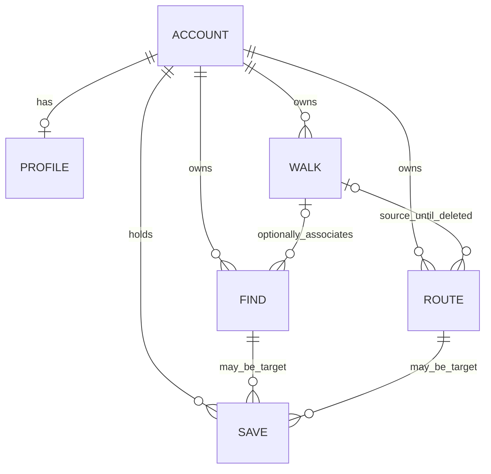
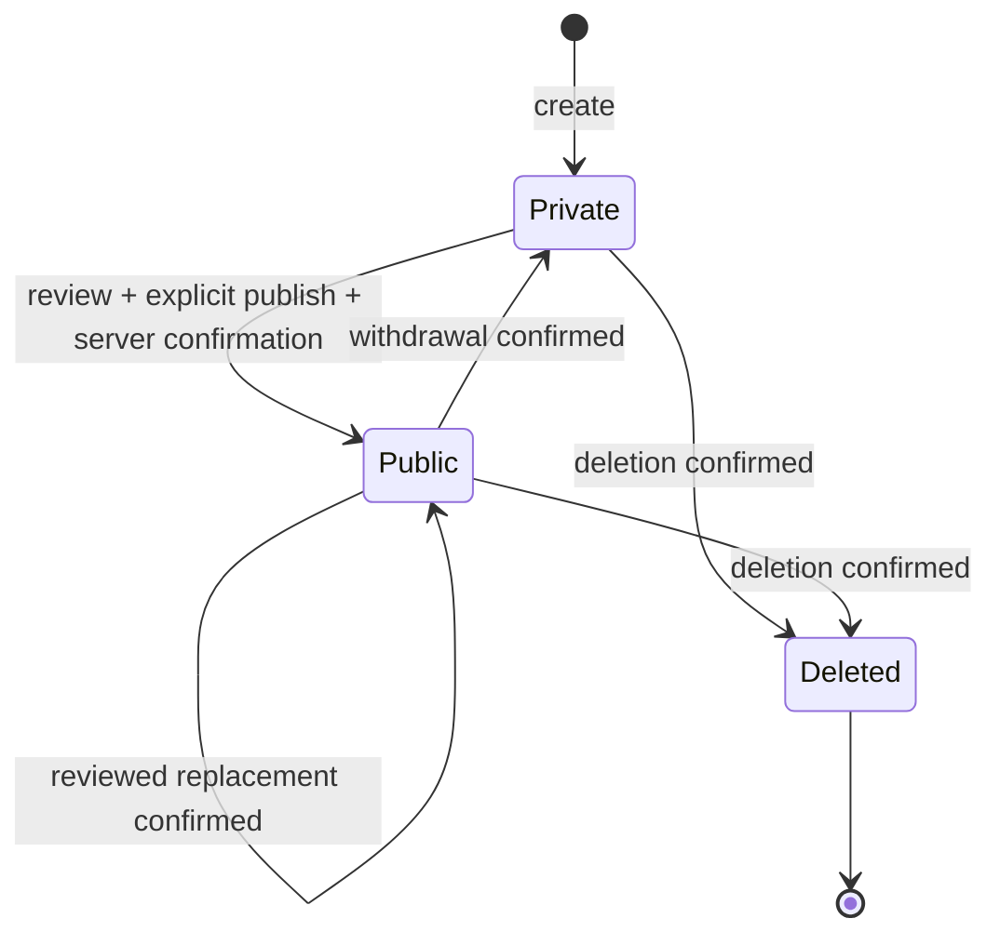

# Wandr — MVP Domain Model

**Status:** Product-owner reviewed and approved for completion of issue #2. Explicit domain blockers remain below.
**Tracking:** [Issue #2](https://github.com/moralesbang/wandr/issues/2).
**Authority:** [Product-approved PRD](../product/prd.md), then [canonical glossary](../../GLOSSARY.md). [Vision](../vision.md) and [handoff](../handoff.md) provide historical context, not additional MVP scope.
**Baseline:** `a793e63`. Conversation in Spanish; artifacts in English.

## 1. Scope and decision boundary

This is a conceptual model, not a database schema, API contract, synchronization protocol, or class design. It records the product-owner interview for issue #2. Accepted decisions are distinguished from unresolved behavior; ending the interview does not resolve the latter by implication.

No PRD scope changes were approved. In particular:

- Routes are useful privately for repeating one's own walk in the original path order; publication is optional. This does not add turn-by-turn navigation.
- A Profile is an optional public showcase, not an access-control audience. There is no private-profile follower audience in the MVP.
- Conflict handling must be explicit and preserve pending work, but no merge or stale-write rejection policy was approved.
- No policy accepting discontinuous Route geometry was approved.
- Collections, Notes, follows, blocking, unlisted sharing, and export remain excluded. Collection is a deferred concept, not a modeled MVP entity.

## 2. Concepts and responsibilities

“Entity” below means a concept with continuity of identity, not a prescribed table. Supporting concepts do not imply separate storage.

| Concept | Classification | Responsibility |
| --- | --- | --- |
| Account | Entity | Authenticated ownership identity, email verification, account timezone, administrative standing, and deletion. Not a claim of one account per human. |
| Profile | Optional account-owned presence | Public pseudonymous showcase with optional avatar, phrase, bio, and Instagram link. At most one per Account; disabled by default. No independent person or ownership identity. |
| Walk | Entity | Personal walking experience and private journal entry. An occurrence date alone is sufficient. GPS, title, text, photos, duration, distance, and steps are optional. |
| Find | Entity | Persistent discovery requiring nonempty text or at least one photo. Can exist without location or a Walk. |
| Route | Entity | Reusable path proposal derived from one eligible Walk. Useful privately, independently publishable, and not a live track. |
| Save | Private reference concept | An Account's reference to one Find or Route. Not a copy, endorsement, Collection, or access grant. Continuity matters through temporary unavailability; storage identity and duplicate-save behavior are not specified here. |
| Public representation | Resource-owned value concept | Selected, reviewed public content distinct from private source data. At most one current public representation per resource; no public version history. |
| Media asset | Supporting identity-bearing concept | Private original and sanitized derivatives used by resources. Its identity is separate from any one resource's use of it. |
| Media use | Supporting relationship | A resource's use of a photo, including its independent public authorization. Sharing an asset does not share another resource's access rights. |
| Recording | Supporting lifecycle concept | In-progress or interrupted capture of available GPS and measured steps. Not a public resource and not evidence of uninterrupted real-world activity. |
| Track / reviewed geometry | Distinct value concepts | Private captured path versus the separately reviewed geometry selected for a Route. Neither is an alias for the other. |
| Occurrence date / measurements / location choice | Value concepts | Calendar date of the experience; measurements with provenance and availability; Find location choice of none, approximate area, or exact point. |
| Tag | Catalog value | Wandr-defined classification for Finds and Routes, not user-created vocabulary. |
| Report | Entity | Private allegation against public content, submitted by a verified account. Does not itself remove content. |
| Moderation action | Audit-bearing domain record | Administrator decision with reason, affected target, and author notification obligation. Distinct from a Report. |
| Journal, Explore, statistics, streak | Derived views | Authorized projections of resources and current history, not additional owned content entities. |

Authentication credentials, sessions, notification delivery, and upload mechanisms are not elaborated into domain entities here.

## 3. Ownership and relationships

Each Save targets a Find **or** a Route, never both. The two target edges express alternatives, not two mandatory relationships. Each Route has exactly one source Walk at creation; the optional edge describes its lifetime after source deletion.

| Relationship | Cardinality and rule | Removal behavior |
| --- | --- | --- |
| Account → Walk / Find / Route | One owner per resource; zero or more resources per Account. No co-ownership. | Account deletion removes owned resources; no community reassignment. |
| Account → Profile | Zero or one Profile. | Disabling removes the public showcase, not publications or Account. |
| Walk → Find | Zero or more Finds per Walk; zero or one Walk per Find. Both must have the same owner. | Walk deletion removes the association, preserving the Find. |
| Walk → Route | Zero or more Routes per Walk; exactly one eligible same-owner source at creation. No multi-Walk derivation. | Walk deletion removes the association, preserving Route identity and its independent path. |
| Account → Save → target | Each Save belongs to one Account and targets one Find or Route. | Visibility loss does not preserve access. Temporary withdrawal retains an unavailable reference; definitive deletion never retargets it. |
| Resource → public representation | Zero or one current representation. | Withdrawal revokes public access; resource deletion removes its representation. |
| Resource → media uses | Resources can use multiple photos; a photo can be used by more than one resource. | Removing one use must not destroy another resource's photo. |

There is no approved general policy for manually moving a Find between Walks, detaching a Route without deletion, or transferring ownership; do not infer those capabilities from these cardinalities.

## 4. Private data and public boundaries

### 4.1 Independent publication

Every Walk, Find, and Route starts private. Publishing one never publishes another or enables a Profile. Public links may expose only related resources that are independently public and otherwise accessible; private association details must not leak. Public resources without an enabled Profile must not automatically link to an author's publication history. (PUB-01–03, PROF-01, NFR-01–02.)

An explicit reviewed update replaces the entire current public representation on server confirmation. Until then, the prior representation remains available. Failure leaves it unchanged. Private edits alone never alter it. No public historical versions are promised.

| Resource | Public boundary |
| --- | --- |
| Walk journal | Selected title/text/photos only; no private track, occurrence date/time, duration, or distance. Walks are not Explore results. |
| Find | Selected public content and explicit location choice. No occurrence date/time or automatic photo-derived coordinates. Approximate locations must be areas, not misleading exact pins. |
| Route | Public title, description, selected public fields, and reviewed geometry. No source track reference granting private access, recording timestamps, or private source-Walk details. |
| Profile | Optional public identity fields and already-public content only. No private resources, statistics, followers, or recent-activity feed. |

User-authored imagery and text can reveal dates or identity despite these boundaries; publication guidance must warn about that limitation. Exact Find pins require warning and confirmation. Public discovery and indexing require no account. (WALK-05, FIND-02–04, ROUTE-05–06, EXP-01, PROF-02–03, PUB-05–06.)

### 4.2 Media access is per use

Originals remain private. Public derivatives must remove sensitive EXIF, including coordinates; sanitization alone does not authorize access. A public use never exposes an original's private URL. Public pages, metadata, and media access obey the same authorization boundary. (MEDIA-01, PUB-04–05, NFR-01–02.)

If the same photo appears in a Walk and a Find:

- Deleting the Walk removes that use, not the Find's photo.
- Deleting the Find removes its photo use; a Walk using that photo retains it.
- If the Find was the only use, its photo is deleted with it, subject to the unresolved retention policy.
- Removing a photo from private content does not silently change the current public representation. A still-published use remains an independent authorized use until updated, withdrawn, deleted, or removed by moderation.
- Withdrawing one resource revokes its public media use, not an independently published use elsewhere. No other use grants continued access through the withdrawn resource.

Physical deduplication, derivative storage, cache revocation mechanisms, and deletion deadlines remain technical/legal work. The domain requires access revocation on confirmation, not instant erasure of external copies.

## 5. Lifecycle dimensions

Do not collapse existence, publication, local synchronization, recording, verification, and moderation into one `status`.

### 5.1 Resource existence and publication

This diagram describes owner publication intent and existence, not moderation availability. A Public resource can be unavailable due to account suspension or content removal. Retention of withdrawn public material internally is not specified.

| Action | Preconditions / result | Invalid behavior |
| --- | --- | --- |
| Create Walk | Authenticated owner; valid occurrence date. Date-only manual entry accepted. | Requiring GPS or treating absent measurements as zeros. |
| Create Find | Authenticated owner; photo or nonempty text; optional same-owner Walk. | Empty Find, mandatory location/Walk, cross-owner association. |
| Create Route | Authenticated owner; one same-owner Walk with eligible GPS geometry. Starts private. | Geometry-free source, drawing/import, implicit multi-Walk composition. |
| Publish / update | Verified owner, not suspended; selected valid public content; explicit review/confirmation; server confirmation. Route additionally requires title, description, and reviewed geometry. | Automatic publication, leaking private fields, success while offline, silent private-to-public updates. |
| Withdraw | Owner action; no publication review required; complete only on server confirmation. | Offline success indication or continuing access through Saves after confirmation. |
| Delete Walk | Owner confirmation explains removed Walk/journal and retained Finds/Routes. | Cascading deletion of independent Finds/Routes. |
| Delete Find / Route | Owner-authorized deletion removes resource and public access; media uses handled independently. | Saves retaining content or reassigning identity to another resource. |
| Delete Account | Explicit confirmation; server confirmation removes all publications and places private data into deletion process. | Community reassignment or keeping owned Finds/Routes public. |

Rejected, pending, or failed actions must not be presented as completed transitions. Content removed by moderation cannot bypass that removal through an ordinary owner publication action; the permissible administrative restoration path remains unresolved.

### 5.2 Recording and offline work

A recording may be active, interrupted and awaiting an owner decision, retained as a Walk, or discarded. These are conceptual distinctions, not a device support guarantee. On recovery after a shutdown, the last captured point is not asserted to be the actual end of the real walk. The owner can retain recovered data, discard it, or manually record the experience. No missing segment is invented. (WALK-02–03, STEP-01–02, OFF-01.)

A persisted manual Walk needs no Recording. Steps are measured only during Wandr recordings; no estimates, whole-day imports, or external health history. Sensor absence must not block journaling.

Pending, failed, synchronized, and conflict-requiring-attention work must be distinguishable. Photos can remain local pending transfer; failed transfers are retryable. Retrying the same operation must not duplicate its resources. Publication and withdrawal require server confirmation; pending withdrawal explicitly means the resource remains public. (MEDIA-02, OFF-01–03.)

Approved conflict guarantees: pending/conflicting work remains visible, no silent loss, and no false success. **No** stale-edit rejection, automatic merge, last-write-wins, deletion-precedence, or cross-device operation-order policy was approved. A delete-versus-update or withdrawal-versus-pending-publication race therefore remains a blocker, not a completed transition specification. See D-05.

### 5.3 Account, Profile, and moderation

Email verification and administrative standing are independent. Unverified accounts cannot publish or report; anonymous visitors can discover public content. Profile enablement is separate from both. (ID-01–03, PROF-01.)

An administrator can suspend an Account, hiding all its public resources and Profile. Suspension blocks publication, public updates, and reports, but permits private journal access, withdrawal, and deletion. It does not itself delete private content. The exact private-edit/sync permissions during suspension and reinstatement semantics remain unresolved. Account deletion remains available. (MOD-03–04; interview Q7.)

A verified signed-in account can report public content for personal-information exposure, harassment/hate, inappropriate content, spam, or other, with optional explanation. Reports are private; authors do not see reporter identity. Submission alone does not remove anything. Manual moderation is web-only and administrator-restricted. Removal/suspension requires a recorded reason and audit entry, and the author must be informed. Report workflow states, notification delivery, reinstatement, and appeals are not invented here. (MOD-01–04.)

Disabling a Profile hides its showcase without changing resource publication. Suspension hiding a Profile must not be mistaken for the owner's choice to disable it; restoration policy is pending.

## 6. Route derivation and geometry

A private Route preserves a reusable path for repeating an outing in the same order, independently of its source Walk's lifetime. It is not a repeated Walk occurrence. Dates and recording hours belong to the Walk; preserving private timing cues in a Route after source deletion was not approved as an additional requirement.

Editing a source Walk never automatically changes the Route or its public geometry. The Route's path must remain usable after source deletion; this is conceptual independence, not a requirement to duplicate physical files. Public updates remain explicitly reviewed. Whether/how a Route can be regenerated from edited source data is not specified. (ROUTE-01, ROUTE-05, WALK-06.)

Before publication, title, description, and map review are mandatory. Exactly two geometry choices exist:

1. **Hide start and end** — default. For source path length L > 400 m, remove 200 m along the path from each end. For 0 < L ≤ 400 m, remove L/4 from each end.
2. **Show full route** — full geometry after an exposure warning and map review.

Examples: 1,000 m retains 600 m; 400 m retains 200 m. The threshold discontinuity is deliberate and must not be smoothed away. No trimming sliders or exclusion zones. Neither option guarantees anonymity. (ROUTE-02–06, PRD §6.2.)

Geometry eligibility with gaps, zero length, loops, or invalid segments, and minimum publishable geometry remain OQ-02. No acceptance of loops or discontinuities was approved in this interview. Recovery of a recording does not itself establish Route eligibility.

## 7. History, streaks, and statistics

### 7.1 Approved history semantics

- Statistics and current/best streaks derive from current retained history, not immutable achievements. Retroactive creation, date correction, and deletion trigger recalculation.
- Multiple same-day Walks each count as Walks in a chain. Distinct walking days are counted separately.
- Past dates, including dates before Account creation, are allowed. Future occurrence dates are not.
- A Walk's occurrence date stays as recorded when the Account timezone changes; travel does not silently move journal entries to another date.
- The Account timezone is initialized from the device and can be explicitly changed. This is not a decision to follow every device timezone change automatically.
- No policy splitting a midnight-crossing Walk into multiple Walks or dates was approved.

These are approved refinements of STAT-01–03 and OQ-04, not a claim that timezone calculations are fully specified.

### 7.2 Streak window — preserve the approved fixture

Use the Account timezone and the occurrence date, not upload time. For Walk date D, start the continuation window at 00:00 on D+1; the cutoff is 48 hours after that instant. A continuation must occur before the cutoff; at the cutoff the window has expired. A date-only manual Walk participates. Streak values count chained Walks, not consecutive days. (STAT-03, PRD §6.3.)

**Acceptance fixture:** a Walk on November 19 starts its window on November 20 at 00:00. It expires on November 22 at 00:00. A Walk on November 21 continues the chain. A Walk on November 22 does not continue that window.

**Unresolved:** DST elapsed-hour versus calendar-boundary behavior; evaluating old/current windows after an explicit timezone change; date-only versus precisely timed eligibility at DST boundaries; date assignment for midnight-crossing recordings; current-streak display exactly at expiration. Stable stored dates do not settle these questions. Do not substitute a consecutive-day rule.

### 7.3 Statistics and steps

All statistics are private. Show Walk/Find counts, distinct walking days, current/best streak, available duration/distance, and measured steps. Distinguish measured, manually declared, and missing values; missing is not measured zero. Deletion changes corresponding counts and history-based calculations. Association removal alone does not delete a Find or remove it from Find counts. (STAT-01–02.)

For recorded-step daily averages, intersect the current Monday–Sunday week, current calendar year, or Account history with Account creation through today inclusive, in the Account timezone. Sum available Wandr-measured steps and divide by included calendar dates. Include no future dates or dates before Account creation. A day without a recorded Walk contributes zero recorded Wandr steps, not zero physical activity. A Walk without readings marks coverage partial; do not estimate its steps. (STEP-01–04, PRD §6.4.)

**Fixture:** Account created Monday, viewed Wednesday: 3,000 measured steps Monday, no Walk Tuesday, 1,500 Wednesday → 4,500 / 3 = 1,500 daily recorded steps. Adding a manual Walk without readings leaves the numerator unchanged and marks coverage partial. A pre-account Walk can affect journal/streak history but contributes no steps to these bounded averages.

## 8. Saves and discovery

Saves are private references to Finds and Routes only. Authentication is required; email verification is not separately required by SAVE-01. Public target access still depends on current publication and moderation availability.

Withdrawal retains an unavailable Save without photo, text, location, or residual content access. Republishing the same resource makes that reference usable again. A definitively deleted target never redirects to another resource. Cleanup/display of definitively deleted references, duplicate saves, and saving one's own/private resources remain unspecified rather than implicitly supported. (SAVE-01–02.)

Explore includes public Finds and Routes, not Walk journals. Unlocated Finds can appear in lists, not as map pins. Manual area selection works without location permission. Tags come from the predefined catalog. Ordering, geographic matching, combined-filter behavior, and treatment of unlocated Finds under area filters remain OQ-06, not new ranking entities. (EXP-01–04.)

## 9. Scenarios and counterexamples

| Scenario | Required outcome | Forbidden counterexample | Trace |
| --- | --- | --- | --- |
| Date-only manual Walk | Private journal entry; eligible for history/streak calculations. | Refusing it for missing GPS or adding measured zeros. | WALK-01, STAT-02–03 |
| Standalone text-only Find | Valid without Walk, photo, or location. | Requiring a map pin. | FIND-01–03 |
| Private Walk with public Find | Only reviewed Find data is public. | Publishing its Walk, track, or occurrence time through the association. | PUB-02, FIND-04 |
| Private Route for repetition | Owner can retain the reusable path without enabling Profile or publishing. | Making Route usefulness contingent on public sharing. | ROUTE-01, PUB-01; Q10 |
| Source Walk edited after publication | Existing Route and public journal remain unchanged until their independent reviewed updates. | Public geometry silently follows the source track. | PUB-03, ROUTE-05 |
| Source Walk deleted | Walk/journal unavailable; Finds/Routes survive with same owner and removed association. | Route depends on accessing a deleted private track. | WALK-06 |
| Photo shared by Walk and Find | Deleting Find removes its use, not Walk's photo. | Cascading deletion destroys another memory. | MEDIA-01; Q12 |
| Offline withdrawal | Clearly pending; publication remains public until server confirms. | “Withdrawn” shown as completed while offline. | OFF-02, PUB-04 |
| Saved Find withdrawn | Save unavailable without retained content; same-resource republication restores access. | Serving a cached copy as a Save entitlement. | SAVE-02; Q9 |
| Content removed by moderator | Public content/media and Save access unavailable; reason/audit and author notice required. | Owner bypasses removal by ordinary republishing. | MOD-03–04, SAVE-02 |
| Account suspended | Public resources/Profile hidden; private access and deletion retained; publication/reports blocked. | Suspension silently deletes private journal. | MOD-04; Q7 |
| Account deleted | All its publications unavailable on confirmation; owned private content enters deletion process. | Orphan Finds/Routes become community-owned. | ID-04 |
| Phone shuts down mid-Walk | Recovered capture is interrupted, awaiting retain/discard/manual-entry choice. | Last GPS point asserted as actual end, or missing path invented. | WALK-03; Q13 |
| Two devices edit/delete the same resource | Pending conflict visible; no false success or silent loss. Exact resolution blocked on D-05. | Treating unapproved last-write-wins or automatic merge as settled. | OFF-03; Q14 |

## 10. Explicit unresolved decisions and next steps

The owner requested no further interview questions. These are deliberate gaps, not approved defaults. “Owner” below assigns the next decision role, not an implementation commitment.

| ID | Unresolved domain decision | Owner / next step | PRD reference |
| --- | --- | --- | --- |
| D-02 | Eligible source/public geometry, discontinuities, invalid/zero-length data, minimum geometry, and review validity if geometry changes. | Product owner with geospatial/mobile engineering: define examples before Route implementation. Preserve the two choices and trimming formula. | OQ-02 |
| D-03 | Approximate-area granularity and representation that does not expose the original exact point. | Product owner with privacy/geospatial review before location publication. | OQ-03 |
| D-04 | DST, timezone-change recalculation, midnight-crossing date assignment, and current-streak expiration semantics. | Product owner with engineering: approve fixtures before full streak/statistics calculation. Preserve November 19–22 and stable journal dates. | OQ-04 |
| D-05 | Per-data conflict policy, mergeable fields, delete/update and withdrawal/publication races, stale review handling, and local account/session isolation. | Technical design proposes policies from available data; product owner approves user-visible outcomes before sync/publication implementation. No protocol designed here. | OQ-05 |
| D-06 | Save duplicate/self/private-target rules, final-deletion reference presentation; tag catalog and area/filter matching semantics. | Product owner before Saves/Explore implementation; defer ranking/curation mechanics unless they affect domain behavior. | SAVE-01, OQ-06 |
| D-07 | Report lifecycle/closure, permissible restoration after removal, suspension duration/reinstatement and republication behavior, private-edit/sync permissions while suspended, and already-pending report/action handling. | Product owner and moderation lead before moderation implementation. Notification delivery, appeals/contact, and handling targets remain operational work. | OQ-07 |
| D-08 | Retention/deletion deadlines, backups, administrative audit retention, and revocation mechanisms. | Privacy/legal and engineering before launch. Confirmed public inaccessibility remains mandatory; no instant external-cache deletion promise. | OQ-08 |
| D-10 | Valid minimum public Walk/Find content, Profile field removal effects, and detailed review/deletion flows where not specified above. | Product owner with UX before affected publication/profile flows. Do not infer a Profile audience or weaken independent publication. | WALK-05, FIND-01, OQ-10 |

Recording/device support and interruption guarantees remain OQ-01. Operational limits, accessibility thresholds, legal jurisdiction, launch geography/age policy, and pilot metrics remain OQ-07–12 as applicable. They are not silently answered by this model.

## 11. Review and completion

- Interviewed decisions above were accepted by the product owner; further questions were explicitly stopped.
- The product owner reviewed and approved this document and the glossary changes, and authorized completion of issue #2.
- Remaining blockers have explicit roles and next steps; this model is not fully implementation-ready for affected areas.
- No SQL/Drizzle schema, endpoints, code, prototype, or synchronization protocol is included.
- No new ADR is added: the major private/public boundary already follows the approved PRD; unresolved conflict and geometry trade-offs are not decisions to memorialize yet.
- Repository completion is recorded in issue #2 with the documentation commit. Approval completes this definition step; it does not resolve the explicitly deferred decisions.
