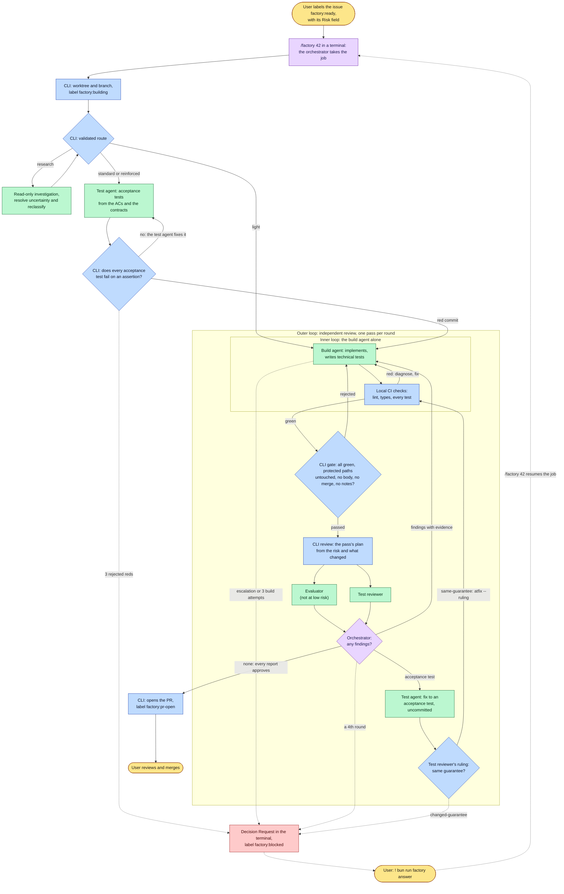

# The Wandr factory

The factory takes a GitHub issue to an open pull request with agents. It is half of the project: Wandr's first goal is to show how an agentic coding system is built while the whole project is managed with AI, so the factory is worth more than the product it builds.

It **delegates execution, not authority**: agents write the tests and the code, deterministic checks they can't change give the verdict, and the user approves what is built and merges it.

How it got here and what comes next: [`versions/`](versions/).

## The flow

Yellow is the user, purple the orchestrator, blue the CLI's deterministic steps (the ruling is an agent's verdict that the CLI verifies), green the agents, each in its own context, and red a job waiting for the user. Solid lines are the path to a PR; dotted lines leave it. Agents never talk to each other: they hand work over through files in the job's folder and commits on the job's branch.

## Who does what

| Actor | What it is | Decides |
| --- | --- | --- |
| **User** | You | The issue, its ACs and its Risk, every Decision Request, any change to an acceptance guarantee, any exception to a gate, the merge |
| **Orchestrator** | The `/factory` skill ([`SKILL.md`](../.claude/skills/factory/SKILL.md)), in the main session of one terminal | Which station runs next, merging the reviewers' findings, when to raise a Decision Request |
| **CLI** | [`cli/`](cli/), TypeScript on Bun | Nothing: it runs every deterministic step, plans each review pass, fixes each agent's model and effort, and refuses what breaks a rule. Its guard, a hook, judges every tool call a job makes |
| **Test agent** | [`factory-test.md`](../.claude/agents/factory-test.md) | How to test each AC through the public contracts |
| **Build agent** | [`factory-build.md`](../.claude/agents/factory-build.md) | How to implement, and which technical tests earn a place |
| **Evaluator** | [`factory-evaluator.md`](../.claude/agents/factory-evaluator.md) | Whether the result meets the issue's intent and the architecture |
| **Test reviewer** | [`factory-test-reviewer.md`](../.claude/agents/factory-test-reviewer.md) | Whether the tests guarantee what matters; whether an acceptance-test fix keeps its guarantee |
| **Diagnosis agent** | [`factory-diagnose.md`](../.claude/agents/factory-diagnose.md) | Why a build keeps failing: a technical cause or a functional ambiguity |

**Model and effort are the CLI's.** Before every Agent call the orchestrator runs `factory launch <n> <agent> --task <task>` and copies the `model` and `effort` it prints; the table is `LAUNCH_TABLE` in [`cli/src/launch.ts`](cli/src/launch.ts). Judging runs get Opus, writing runs Sonnet. A run the table doesn't hold (an evaluator at low risk) doesn't happen. The skill's frontmatter sets the orchestrator's own setting, and its body restates it, because frontmatter applies only to the turn that loads the skill. Agents that need to map code hand the search to a Haiku `Explore` subagent, whose reads count as theirs.

## Routing and workflows

Before any implementation the orchestrator reads the issue and the code, writes a classification proposal and runs `factory route`. The proposal holds three independent dimensions, plus the exact expected paths, whether behavior changes, the evidence, open questions and the verification needed. Only the CLI picks the workflow from it.

| Dimension | Values | Chooses |
| --- | --- | --- |
| Scope | `frontend`, `backend`, `fullstack`, `tooling`, `docs` | The context and verification profile ([quality](docs/quality.md#scope-profiles)) |
| Complexity | `small`, `standard`, `uncertain` | The stations the work needs |
| Risk | `low`, `normal`, `high` | The reviewers and their depth |

A small backend authorization fix can be high risk; scope is not a synonym for complexity or risk.

| Workflow | Eligibility | Stations |
| --- | --- | --- |
| `light` | Low risk, small, no behavior change, every path in `README.md`, Markdown under `docs/` or CSS under `apps/web/src/` | Build, all local checks, independent test review, PR |
| `standard` | Behavior changes, and anything not eligible for another workflow | Acceptance tests, verified red, build, all checks, risk-sized review, PR |
| `reinforced` | High risk, including the sensitive paths of the routing policy | Impact analysis, acceptance tests, verified red, build, all checks, both reviewers at high risk, PR |
| `research` | Uncertain scope or unresolved questions | Read-only investigation, findings in `research.md`, a new classification before any implementation |

The rules that keep a route honest:

- **Risk is a floor.** The issue's Risk field is the declared risk; the CLI raises it from the expected paths and the actual diff (the privacy boundary and tamper-prone files in [`cli/src/risk.ts`](cli/src/risk.ts)), and nothing lowers it. At low risk the test reviewer alone judges the job.
- **Routing follows the diff.** A broader or more sensitive change escalates the plan, invalidates stale verification and requires the new stations before review or a PR. A light job that already has implementation when escalation requires a red raises a Decision Request for a restart: no passing test is relabeled as a red.
- **Light is narrow on purpose.** JSX/TSX copy stays standard, because paths alone can't prove a change cosmetic. Light skips the test writer and the red, never the checks, the independent review, the protected paths (the acceptance tests and the rules a build is judged by, which no build agent may change) or the user's merge.
- **A route authorizes no protected change**: that still takes a Decision Request. Before classification and during research the guard allows only read-only commands and the orchestrator's proposal, research and Decision Request writes.
- **No path-filtered CI.** Every executable workflow runs the same complete local checks. Jobs created before routing keep the standard workflow.

## Read on

- [Isolation](docs/isolation.md): who sees what, the seal and the blind review, the guard, the reviewers' sandboxes, the threat model.
- [Quality](docs/quality.md): acceptance and technical tests, a valid red, the gates, the two loops and their budgets, acceptance-test findings, Decision Requests.
- [Operating](docs/operating.md): a job's states, the pull request, cost per agent, `factory watch` and the event log, where things live.
- The CLI's commands, their flags and what each refuses: `bun run factory` prints its usage.
