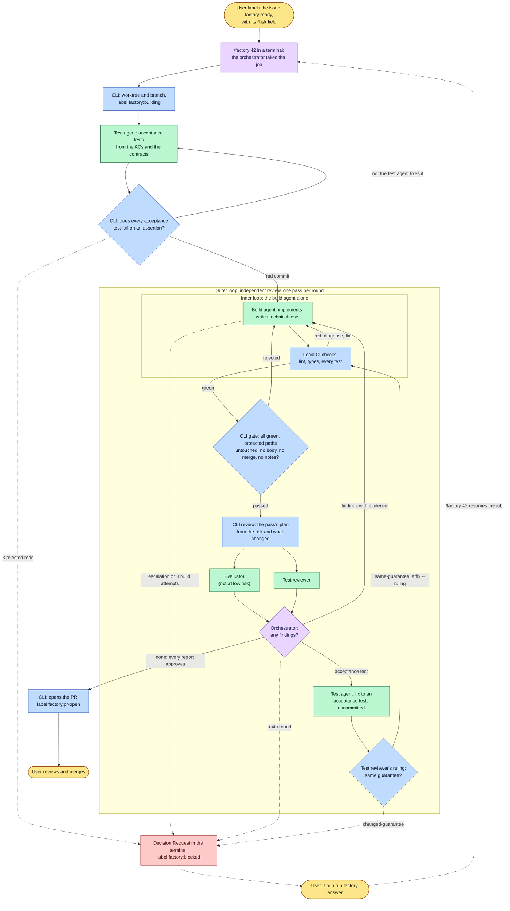
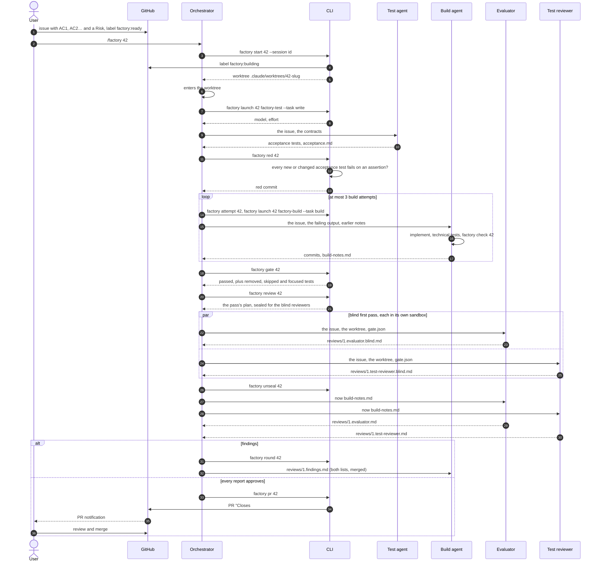
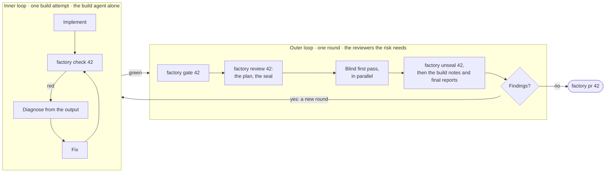
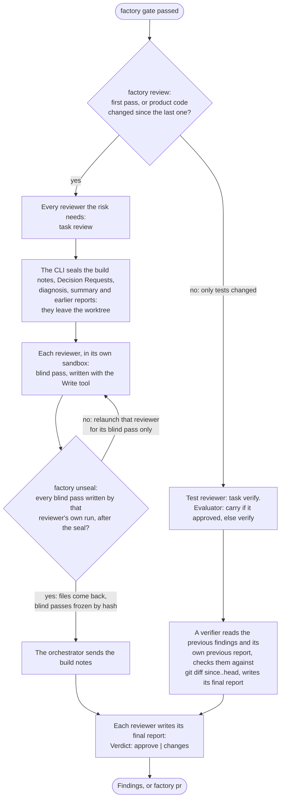
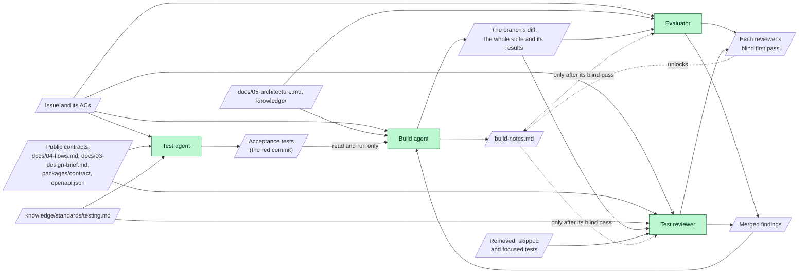
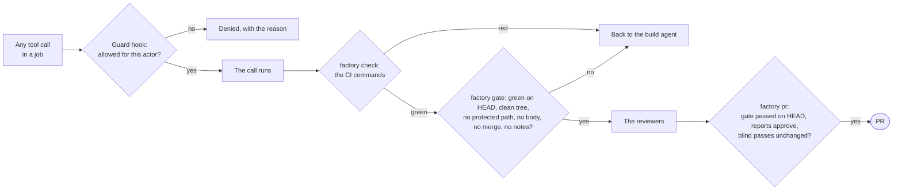
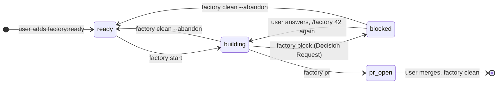
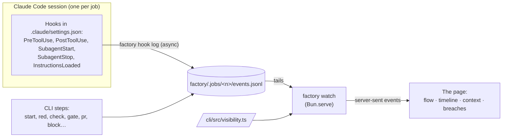

# The Wandr factory

The factory takes a GitHub issue to an open pull request with agents. It **delegates execution, not authority**: agents write the tests and the code, deterministic checks they can't change give the verdict, and the user approves what is built and merges it.

How it got here and what comes next: [`versions/`](versions/).

## The flow



Yellow is the user, purple the orchestrator (the `/factory` skill), blue the CLI's deterministic steps (the ruling is an agent's verdict that the CLI verifies), green the agents, each in its own context, and red a job waiting for the user. Solid lines are the path to a PR; dotted lines leave it.

## Who does what

| Actor | What it is | Model and effort | Decides |
| --- | --- | --- | --- |
| **User** | You | — | The issue, its ACs and its Risk, every Decision Request, any change to an acceptance guarantee, any exception to a gate, the merge |
| **Orchestrator** | The `/factory` skill, in the main session of one terminal | Sonnet, medium | Which station runs next, merging the reviewers' findings, diagnosing a second failed build, when to raise a Decision Request |
| **CLI** | `factory/cli`, TypeScript on Bun | — | Nothing: it runs every deterministic step, plans each review pass, fixes each agent's model and effort, and refuses what breaks a rule |
| **Test agent** | `.claude/agents/factory-test.md` | See the table below | How to test each AC through the public contracts |
| **Build agent** | `.claude/agents/factory-build.md` | See the table below | How to implement, and which technical tests earn a place |
| **Evaluator** | `.claude/agents/factory-evaluator.md` | See the table below | Whether the result meets the issue's intent and the architecture |
| **Test reviewer** | `.claude/agents/factory-test-reviewer.md` | See the table below | Whether the tests guarantee what matters; whether an acceptance-test fix keeps its guarantee |
| **Diagnosis agent** | `.claude/agents/factory-diagnose.md` | See the table below | Why a build keeps failing: a technical cause or a functional ambiguity |

Agents that need to map code first hand the search to a Haiku `Explore` subagent; its reads count as the reads of the agent that launched it.

### Risk

The job's risk decides which reviewers judge it and how hard.

- **Declared.** The issue form's **Risk** field: `low` (copy, styling, docs-like changes with no data path), `normal` (the default) or `high` (the privacy boundary, auth, the data model, migrations). The CLI reads it at `factory start`.
- **Effective.** `factory launch` and `factory review` take the declared risk and raise `low` to `normal` when the branch's diff against its base touches any path below. They never lower a risk and never raise one past `normal`: only the issue declares `high`. The paths that raised it are printed as `raisedBy`.

| List | Paths |
| --- | --- |
| Privacy boundary | `packages/sharing/**`, `packages/contract/**`, `apps/api/src/db/**`, `apps/api/src/routes/**`, `apps/api/src/photos/**`, `apps/api/src/http/cache-control.ts` |
| Tamper-prone files | `**/package.json`, `bun.lock`, `**/vite.config.ts` |

At low risk the test reviewer alone judges the job: there is no evaluator.

### Model and effort

The orchestrator never picks a model or an effort. Before every Agent call it runs `bun run factory launch <n> <agent> --task <task>`, which prints them as JSON, and copies `model` and `effort` into the call's parameters. The table is `LAUNCH_TABLE` in [`cli/src/launch.ts`](cli/src/launch.ts); a pair the table doesn't hold (an evaluator at low risk, an unknown task) is a refusal, and the run doesn't happen. Judging runs get Opus; writing runs get Sonnet.

| Agent | Task | Low | Normal | High |
| --- | --- | --- | --- | --- |
| `factory-test` | `write` | Sonnet, high | Sonnet, high | Sonnet, high |
| `factory-test` | `fix` | Sonnet, medium | Sonnet, medium | Sonnet, medium |
| `factory-build` | `build` | Sonnet, medium | Sonnet, medium | Sonnet, medium |
| `factory-diagnose` | `diagnose` | Opus, high | Opus, high | Opus, high |
| `factory-evaluator` | `review`, `verify` | no run | Opus, medium | Opus, high |
| `factory-test-reviewer` | `review` | Opus, medium | Opus, medium | Opus, high |
| `factory-test-reviewer` | `verify`, `ruling` | Opus, low | Opus, low | Opus, medium |

The skill's frontmatter sets the orchestrator's own model and effort, and its body restates them, because frontmatter applies to the turn that loads the skill and no later one. `launch` refuses on a blocked job and logs each plan as `launch.planned`.

### One job, step by step

Where each step runs and where information moves. Agents never talk to each other: they hand work over through files in the job's folder and commits on the job's branch.



## The two loops



**Build attempts.** A job has one budget of 3 build attempts, shared by both loops. A **build attempt** is one run of the build agent until it stops, and it counts when:

- it is the first run, after the red commit;
- it reruns after a red `factory check`, or after a rejected `factory gate`;
- it reruns because a review round's fix run did not reach green.

A review round's fix run that reaches green costs nothing. Past 3 the job blocks with a Decision Request: `factory attempt` refuses the 4th.

**Inner loop.** The build agent implements, runs the checks, diagnoses and fixes, red–green–refactor where it pays, until `factory check` is green or it stops. Before it finishes it reverts every change that had no effect on the result, so it delivers only changes that worked.

| Attempt | Who runs it | With |
| --- | --- | --- |
| 1 | Build agent, fresh context | The issue and the red commit |
| 2 | Build agent, fresh context | The failing output and attempt 1's notes |
| — | The diagnosis agent | The failing test, the diff, both attempts' notes. A technical cause goes to attempt 3; a functional ambiguity goes straight to a Decision Request |
| 3 | Build agent, fresh context | The diagnosis |
| 4 | — | The job blocks with a Decision Request |

**Outer loop.** A **round** is: the reviewers report findings, the fixes are made, a review pass checks them. Up to 3 rounds with findings; a fourth blocks the job. Every finding carries its evidence: the command, its output, `file:line`.

### A review pass

A pass is sized to what changed since the last reviewed `HEAD`. `factory review <n>` plans it, seals what the blind reviewers mustn't see, and prints the plan: the pass number `<k>`, each reviewer's task, and the paths a verifier reads.



- **`review`**: a full blind review, then a final report. **`verify`**: no blind pass; it checks the previous findings against the diff since the last pass. **`carry`**: no run; the evaluator's earlier approval stands because only tests changed.
- **The seal.** While a blind pass is unwritten, the build agent's reasoning sits in the main checkout, outside every agent's reach, and the job's other commands refuse. `factory seal <n> --pass <k> --roles <role,...>` and `factory unseal <n>` are the two halves; `review` calls the seal itself.
- **`unseal`** refuses until each sealed role's blind pass is non-empty and the event log shows that role's own agent wrote it with the Write tool in a run launched after the seal. It also waits for a verifier's final report, since a verifier reads the previous findings from the sealed store. A seal stuck on a missing blind pass has no override: the reviewer is relaunched.
- **Frozen.** `unseal` records each blind pass's hash; `factory pr` checks it, so a blind pass can't change after the notes are in.
- **Verifiers' reads.** While another reviewer's blind pass keeps the job sealed, a verifier reads only the previous merged findings and its own earlier final reports, from the sealed store. The notes, Decision Requests and the other reviewer's reports stay closed to it until its final report is written.

### Acceptance-test findings

A finding about an acceptance test has one path, and the orchestrator never decides which kind it is:

1. The test agent (task `fix`) changes the test and leaves the change uncommitted.
2. `factory ruling <n>` hashes that uncommitted acceptance-test diff and names the file `<job>/rulings/<m>.md` for the ruling.
3. A fresh test reviewer (task `ruling`, never a message to a running one) reads the diff and writes the ruling file: `Verdict: same-guarantee` or `Verdict: changed-guarantee`, the diff hash unchanged, its reasoning. In doubt it rules `changed-guarantee`.
4. **same-guarantee**: `factory atfix <n> --ruling <m> --note <text>` commits the fix if the hash matches the diff and the log shows the reviewer's own run wrote the ruling. The PR lists the fix.
5. **changed-guarantee**: a Decision Request (below). Once the user answers, either the answer accepts the fix as ruled and `factory atfix <n> --note <text>` commits it, or the test agent makes the change the answer authorizes and `factory rewrite <n> --note <text>` commits that. The PR lists a rewrite apart, under "Authorized guarantee changes".

When acceptance-test fixes are a round's only findings, the round still counts (`factory round`), but no build attempt.

### A Decision Request

Whenever a job needs the user (an escalation, a block, a changed guarantee), the orchestrator writes the request: Context, Evidence, Alternatives, Recommendation, Impact, Risks, standing alone. Only the user answers one, from their own prompt.

```mermaid
sequenceDiagram
    autonumber
    participant O as Orchestrator
    participant C as CLI
    participant G as Guard hook
    actor U as User

    O->>C: factory block 42 draft.md
    C->>C: keeps the request in the job's folder, label factory:blocked
    C-->>O: prints the request
    O-->>U: shows it in full in the terminal
    Note over O: the turn ends; every command that moves the job refuses
    O-xG: a tool call running factory answer
    G--xO: denied: only the user answers
    U->>C: ! bun run factory answer 42 "text"
    Note over U,C: a user-typed ! command fires no PreToolUse hook
    U->>O: /factory 42
    O->>C: factory start 42 --session id
    C-->>O: the job resumes and prints the answer
    O->>C: factory atfix or rewrite, citing the answer
```

**The separation is the guard.** `factory answer` itself checks nothing about its caller. A command typed with `!` fires no `PreToolUse` hook and a model's Bash call does, with the same environment and no TTY, so the guard's denial of `factory answer` to every tool call is what makes an answer the user's.

- **A blocked job doesn't move.** While the job is blocked, `launch`, `attempt`, `round`, `gate`, `check` and every other command that moves it refuse. `factory start` refuses a blocked job until the latest request has an answer, then returns it to building and prints the answer.
- **One answer authorizes one commit.** The answer authorizes a `rewrite`, or an `atfix` when the request was raised on a changed-guarantee ruling. The commit cites it (its body quotes the answer; its trailer is `Authorized-By: factory answer …`) and uses it up: a second commit on the same answer is refused. An answer to any other request authorizes no test change.
- **Nothing is posted on the issue.** The request stays in `<job>/decision-requests/` and in the terminal; only the label moves.
- **Abandoning** a job that shouldn't go on is `factory clean <n> --abandon`.

## Who sees what

Each agent runs as a fresh subagent. It is independent because of what it receives and what it may change, not because its prompt asks it to be.



| Agent | Receives | Starts without | May write |
| --- | --- | --- | --- |
| Test agent | The issue and its ACs, the public contracts, `knowledge/standards/testing.md`, the test infrastructure | Any implementation plan: it runs before the build agent | Acceptance tests and their scaffolding, anywhere outside the rule files below; `acceptance.md` |
| Build agent | The issue, `docs/05-architecture.md`, the repo and `knowledge/`, the acceptance tests (read and run only), the check results, the reviewers' findings, the diagnosis | The test agent's reasoning | Anything outside the protected paths; `build-notes.md` |
| Evaluator | The issue and its ACs, `docs/05-architecture.md` and `knowledge/`, the diff against `main`, the whole suite and its results | The build notes, Decision Requests, diagnosis, summary, the other reviewer's reports and its own earlier final reports, until its blind first pass is written | Its own reports in the job's folder; its own sandbox |
| Test reviewer | The issue and its ACs, the public contracts, `knowledge/standards/testing.md`, the diff against `main`, the whole suite and its results, the CLI's list of removed, skipped and focused tests | The same sealed material as the evaluator, including each technical test's value check, until its blind first pass is written | Its own reports and rulings in the job's folder; its own sandbox |
| Diagnosis agent | Everything in the job's folder and the repo at the branch | Nothing: it has no blind pass | `diagnosis.md` |

Inputs and the moment each becomes visible are declared once, as data, in [`cli/src/visibility.ts`](cli/src/visibility.ts). Three layers apply them:

- **The seal** (see "A review pass") takes the sealed material out of the worktree, so no command can read it there.
- **The guard** denies the same names as a second layer, and denies the channels around them (below).
- **`factory watch`** classifies every read, `Bash`, `Grep` and `Glob` paths included, and marks in red a read outside an agent's inputs or before they became visible, and every denial. Replaying job #13's commands flags the four early reads its blind passes made.

## The guard

A synchronous `PreToolUse` hook, `factory hook guard`, judges every tool call a job makes: its matcher is `*`, not only `Edit` and `Write`. One policy module per tool family (Bash, writes, reads, agent prompts) gives a verdict from the call and the job alone; the hook only logs it.

**Fail closed.** Inside a job, a call the guard can't judge, for any error, is denied, and the error goes to the hook-errors log. Outside a job the hook does nothing. Every path is judged where it leads: symlinks are resolved first, `..` after a link included.

**What it denies, and to whom.**

| To | Denied |
| --- | --- |
| Everyone, the orchestrator included | `factory answer`, `factory hook`, `factory watch` and `factory clean` (the last two and `answer` are the user's); `gh` writes and `git push` (the CLI pushes and posts); `git config`, `git notes`, `claude`; writing the job's state in the main checkout; `factory start` with another session's ID (it would rebind the job and switch its guard off); a command whose factory subcommand or `gh` call the guard can't read from its text (`xargs`, a `$VAR`, `bun -e` loading the CLI) |
| The orchestrator | Every MCP tool and any tool outside a short list during a job; a prompt or message that names or quotes sealed material while the job is sealed; writing a reviewer's files (`reviews/<k>.evaluator*`, `reviews/<k>.test-reviewer*`, `rulings/**`) |
| Every subagent | Any tool the guard has no policy for (every MCP tool included); the main checkout outside the job's worktree, Claude Code's own files (`~/.claude`, transcripts, file history, task outputs), all `gh`, `factory seal`, `unseal` and `review`; any factory command but its own (build and test agents: `check` and `status`; reviewers: `status` and `sandbox` for their own role); writes outside its column; a merge commit |
| A reviewer | The other reviewer's sandbox; the sealed names until its own blind pass is written; test runners and servers outside `factory sandbox exec`; git commands that move a repository outside its own sandbox; `find`, `tar`, `du`, `tree` and `ls -R` from above the job's folder while its blind pass is unwritten |

**Threat model.** The guard stops a hurried or careless agent, and any plain command or tool call. It reads command text, and a shell is open-ended, so a deliberately built command can get past it. Launchers (`env`, `nice`, `sh -c`…), interpreter operands and git's own spellings are judged, but each adversarial review round found spellings the one before missed: a text-parsing Bash guard can't be complete.

**Accepted residual.** A script written then run; code built at runtime (base64, `eval`, string concatenation); an interpreter's own file operations beyond what the guard recognizes; the commit subject; code comments. **OS-level sandboxing of Bash is the planned fix for that class.** Until then the CLI's gate, `unseal`, `atfix` and `pr` don't trust the guard alone: they check the event log for who wrote what, and the commit history for what the gate forbids.

## The reviewers' sandboxes

Two reviewers sharing one port, one `apps/web/dist` and one database see each other's mutations. Each reviewer runs everything through its own sandbox:

- `factory sandbox <n> <role>` makes a disposable detached checkout of the job's `HEAD` under `<job>/sandbox/<role>/`, with its own dependencies, a free port, its own database and its own bucket, and prints them as JSON. `<role>` is `evaluator` or `test-reviewer`.
- `factory sandbox exec <n> <role> -- <command>` runs a command there with that environment (`PORT`, `E2E_PORT`, `DATABASE_URL`, `S3_BUCKET`). Playwright reads `E2E_PORT` and never reuses a server when it is set.
- `factory sandbox rm <n> <role>` removes the checkout, its database and its bucket. `clean` and `clean --abandon` remove them too; that needs the services up (`bun run services`).

A reviewer writes anywhere in its own sandbox and nowhere in another's, and runs servers, builds, mutations and end-to-end tests only through `sandbox exec`.

## Two kinds of tests

| | Acceptance tests | Technical tests |
| --- | --- | --- |
| Question | Did we build the right thing? | Did we build it right? |
| Source of truth | The issue's ACs and the public contracts | Technical contracts, invariants and implementation risks |
| Named | `*.acceptance.test.ts(x)`; every test in `apps/web/e2e/` | `*.test.ts(x)` |
| Author | Test agent, before implementation, in the red commit | Build agent, during implementation |
| Who changes them | The test agent: on a test reviewer's same-guarantee ruling, or with the user's authorization when the guarantee changes | The build agent, as long as no existing guarantee weakens |
| Defended by | The verified red, then green at the end | The value check, then the test reviewer |

The name keeps an acceptance test protected after its job, so no later build agent can weaken a guarantee the user approved. Both kinds follow [`knowledge/standards/testing.md`](../knowledge/standards/testing.md): the value check and "guarantees, not test count" bind every test.

### A valid red

`factory red` runs every new or changed acceptance test and accepts the red only if each file passes lint and format (`oxlint --deny-warnings` and `oxfmt --check`, the worktree's own, as CI runs them), loaded, ran at least one test, and every test fails on an assertion. A file CI would reject is no red to build on: the build agent can't fix it, so it would cost an acceptance-test fix later. One rejection names every problem at once, lint, format and the run, each with its file and the command that fixes or checks it. Vitest and Playwright run with our own reporters (`factory/cli/src/reporters/`), which write one JSON report in a common shape; `bun test` has no custom-reporter API, so the CLI converts its JUnit report into that shape. The rule then works on one shape:

| Runner | Accepted | Rejected |
| --- | --- | --- |
| `bun test` (JUnit, converted) | `type="AssertionError"` | A file missing from the report (a load error) |
| Vitest (own reporter) | An error named `AssertionError` | A load error on the file's module |
| Playwright (own reporter) | A failed step of the `expect` category | A load error, a file with no test in the run, a timeout |

In every runner, a thrown error, a timeout, a load error, a skipped test, a passing test and a file with no test also reject the red.

Any other error rejects the red and the test agent fixes it. `factory red` records each rejection: after 3 rejected reds the job raises a Decision Request and `red` refuses a 4th. So scaffolding is stubs with the right signature that return an empty value and never throw, plus empty routes or screens; an end-to-end test asserts that an element is visible before acting on it.

## The gates



**What the gate checks beyond the diff.** Every commit of the job that the CLI didn't make:

- **has no message body.** A build commit is a subject line and trailers only (`Co-Authored-By`, `Signed-off-by`, `Claude-Session`, `Factory-Job`, `Refs`, `Closes`, `Fixes`); the reasons go in `build-notes.md`, which the seal protects. A body would carry them past the seal in `git log`. The gate also expires the reflogs of `HEAD` and the job's branch, so a body amended away stays unreadable there.
- **is not a merge.** A merge's own diff is empty, which would hide its changes from the gate; agents rebase onto `main`.
- **leaves no git note.** `refs/notes/*` rides along with `git log --show-notes` past the seal.

**Protected paths.** `factory gate` rejects a build whose diff since the red commit touches any of these, and the hook denies the build agent writing them. Commits already on `main`, fetched by the gate itself, aren't the job's: a job that merges `main` to pick up a fix doesn't answer for them.

| What | Paths |
| --- | --- |
| Acceptance tests | `**/*.acceptance.test.ts`, `**/*.acceptance.test.tsx`, `apps/web/e2e/**` |
| CI | `.github/workflows/**` |
| Lint and format | `.oxlintrc.json`, `.oxfmtrc.json`, `packages/oxlint-plugin-wandr/**` |
| TypeScript | `packages/tsconfig/**`, `**/tsconfig*.json` |
| Test runners and the task graph | `apps/web/playwright.config.ts`, `bunfig.toml`, `turbo.json` |
| The rules and the factory | `CLAUDE.md`, `knowledge/**`, `factory/**`, `.claude/**` |

The test agent may write acceptance tests but none of the other rows. `package.json` and `vite.config.ts` aren't protected, because dependencies and plugins change legitimately; the evaluator checks them for tampering. A job that needs to change a protected path escalates with a Decision Request.

**The local checks** are the commands in [`ci.yml`](../.github/workflows/ci.yml), run with `CI=1` in the job's worktree, each step's script handed to `bash --noprofile --norc -eo pipefail -c` as one argument, as GitHub Actions runs it, so its newlines, line continuations and `$VAR`s reach bash untouched: `bun install --frozen-lockfile`, `bun run services`, `bunx turbo run lint typecheck test build`, `bunx oxfmt --check`, the generated-files check, `db:migrate:test` and `bunx turbo run e2e`. Every job shares the same test database, bucket and Playwright port, so a machine-wide lock lets one job run checks at a time; the others wait in line. They share one Docker stack too: `docker-compose.yml` names its project `wandr`, so `bun run services` from any checkout or worktree reuses the same containers and volumes instead of starting a stack that fights over ports 5432 and 9000. Its config holds no host path, so starting it from another checkout doesn't recreate a container. `factory red` takes the same lock.

## A job's states



| State | Label on the issue | Set by |
| --- | --- | --- |
| ready | `factory:ready` | The user |
| building | `factory:building` | `factory start` |
| blocked | `factory:blocked` | `factory block` |
| pr_open | `factory:pr-open` | `factory pr` |

**Abandoning a job.** A job that shouldn't go on, because the factory itself needs a fix or the issue needs rewriting, is discarded with `factory clean <n> --abandon`, in this order: it records `job.abandoned` in the job's log (the last event `factory watch` shows), takes down any compose stack the worktree started on its own, with its volumes but never the shared `wandr` stack, removes the reviewers' sandboxes and the worktree, deletes the branch locally and on `origin`, deletes the job's state folder, and moves the issue's label back to `factory:ready`, as it was before `factory start`. `/factory <n>` then starts the issue from scratch. It refuses while the branch has an open PR, which you close by hand first, and when the PR merged, which is plain `clean`.

**Knowing a job ended.** An open PR reaches you as a GitHub notification; a Decision Request appears in the orchestrator's terminal; the label shows where the job stands; `factory watch` shows it live.

## Commands

### In Claude Code

| Command | What it does |
| --- | --- |
| `/factory 42` | Runs the job for issue 42 in this session, from intake to an open PR or a Decision Request. Running it again on a blocked, answered job resumes it. Up to 3 jobs at a time, one terminal each. |

### The CLI

Run from the repo root as `bun run factory <command>`; `bun run factory` alone prints the usage. The orchestrator runs every command except the user's three below; an agent runs only the few its role allows (see "The guard").

| Command | What it does | Refuses when |
| --- | --- | --- |
| `start <n> --session <id>` | Creates `.claude/worktrees/<n>-<slug>` on `feat/<n>-<slug>`, installs, reads the issue's Risk, writes the job's state (`job.json`) in the main checkout and `issue.md` in the job's folder, moves the label to `factory:building`, and prints the job with its folder's path. On an existing job, copies in any handoff file that exists only in the main checkout; on a blocked job, moves the label back and prints the user's answer; on a sealed job, says which blind passes are missing | The issue lacks `factory:ready` or numbered ACs; 3 jobs already run; the job is blocked and its latest Decision Request has no answer |
| `launch <n> <agent> --task <task>` | Prints the `model` and `effort` for one agent run at the job's effective risk, plus the risk and what raised it, and logs the plan. Tasks: `write`, `fix`, `review`, `verify`, `ruling`, `diagnose`, `build` | The table has no such run (an evaluator at low risk, an unknown agent or task); the job is blocked |
| `red <n>` | Checks lint and format on the new or changed acceptance tests, runs them, and commits them as the red commit | A file fails lint or format; a test passes, or fails on anything but an assertion; 3 reds were already rejected |
| `check <n>` | Runs the CI commands under the lock and saves the output in the job's folder | — (exits non-zero on red) |
| `attempt <n>` | Records a build attempt (see "The two loops" for which runs count) | It would be the 4th |
| `gate <n>` | Checks the last `check` was green on `HEAD`, the tree is clean, no protected path changed, and no commit has a body, is a merge or leaves a note; writes the list of removed, skipped and focused tests | Any of those fails |
| `review <n>` | Plans the review pass: the pass number, each role's task (`review`, `verify` or `carry`), the risk, and the paths a verifier reads; seals the blind reviewers | The job is blocked or sealed; `HEAD` moved after the pass was planned (a change after a pass goes through a round). Rerunning on the same `HEAD` prints the same plan |
| `round <n>` | Records a new outer-loop round with the merged findings (`reviews/<k>.findings.md`), acceptance-test fixes included | It would be the 4th; the findings file shares 8 consecutive words with `build-notes.md` |
| `ruling <n>` | Hashes the uncommitted acceptance-test fix and prints the ruling number and the file a test reviewer rules in | No uncommitted acceptance-test change; the job is blocked or sealed |
| `atfix <n> --ruling <m> --note <text>` | Commits the fix on a same-guarantee ruling and records it for the PR | The ruling isn't `same-guarantee`, its diff hash doesn't match, the log doesn't show the reviewer's own run wrote it, anything but acceptance tests changed, or no note |
| `atfix <n> --note <text>` | After the user answered a Decision Request raised on a changed-guarantee ruling, commits the fix as ruled, citing the answer | No such answer, or it was already used |
| `rewrite <n> --note <text>` | Commits the test agent's rewrite of acceptance tests after the user's answer authorized a change of guarantee; the commit cites the answer and the PR lists it | The latest Decision Request has no unused answer, anything but acceptance tests changed, or no note |
| `block <n> <file>` | Keeps the Decision Request in the job's folder, prints it, label `factory:blocked` | The job is already blocked or sealed |
| `seal <n> --pass <k> --roles <role,...>` | Moves the build notes, Decision Requests, diagnosis, summary and earlier reports out of the worktree for the blind pass of those reviewers; `review` calls it | The job is sealed already, or `<k>` isn't the pass under way |
| `unseal <n>` | Puts the sealed files back once every sealed role's own agent wrote its blind pass, and freezes each pass by its hash | A blind pass is missing, empty or not written by its reviewer's own run; a verifier hasn't written its final report |
| `answer <n> "<text>"` | Records the user's answer to the job's latest Decision Request | The job isn't blocked, or the request already has an answer. **The user's only**, with `!` |
| `sandbox <n> <role>` | Makes a reviewer's sandbox and prints its path, port, database and bucket | An unknown role |
| `sandbox exec <n> <role> -- <command>` | Runs the command in that sandbox with its environment | There is no such sandbox |
| `sandbox rm <n> <role>` | Removes the sandbox, its database and its bucket | — |
| `pr <n>` | Pushes the branch, opens the PR, posts the cost table, the build notes and the final reports as a comment, label `factory:pr-open` | The gate didn't pass on `HEAD`; a role's final report is missing or doesn't approve; a blind pass changed since the unseal; the job is sealed |
| `status` | Lists the jobs and where each stands | — |
| `watch [--port <port>]` | Serves the live page on `localhost`, printing a URL with its token. **The user's only** | — |
| `clean <n>` | Removes a merged job's worktree, branch, sandboxes and folder. **The user's only** | The PR isn't merged |
| `clean <n> --abandon` | Discards a job that won't merge, so its issue can start again (see "A job's states"). **The user's only** | The branch has an open PR (close it first) or a merged one |
| `hook log` · `hook guard` | Entry points for Claude Code's hooks; not run by hand | — |

**Commands only the user runs, each with `!` from their own prompt** (`! bun run factory <command>`): `answer`, `clean` (either form) and `watch`. A `!` command fires no hook, and the guard denies all three to every tool call, the orchestrator's included.

**The pull request** is titled after the issue and its body holds `Closes #<n>`, a summary of the change, each AC with the acceptance tests that check it (from `acceptance.md`), the result of the local checks, any same-guarantee fixes to acceptance tests, and, in a separate section, any authorized guarantee changes with the note that cites each authorization. The comment beside it opens with the cost per agent, then holds the build notes and the final reports, so they stay on record in GitHub.

### Cost per agent

The `SubagentStop` and `Stop` hooks read each run's transcript, deduplicate by message ID, and log one `usage` event per run: tokens by kind (5-minute and 1-hour cache writes priced apart), the models and efforts seen, and the cost from a dated price table in `cli/src/prices.ts`. A model the table doesn't price is listed as unpriced, not guessed. `factory watch` shows each run's cost and the job's total; the PR comment's first section is the per-agent table: agent, model, effort, input, output, cache read, cache write, cost.

## Watching a job

`bun run factory watch` serves one page that shows every running job live, with no reload. Its purpose is to make the factory checkable: to spot an agent doing something you don't want, reading more than it should, or seeing work it should be blind to.



**The event log.** Every job appends to `factory/.jobs/<n>/events.jsonl` in the main checkout, written only by the CLI and by Claude Code hooks, never by an agent: the main checkout is outside the worktree agents are confined to, and `factory/` and `.claude/` are protected paths inside it.

- Hooks are declared in `.claude/settings.json`, because they fire inside every subagent; hooks in a skill's frontmatter don't. Each logging hook is `async`, so it never slows an agent down.
- A hook finds its job by the session: `factory start` records the session's ID, and every event in that session, its subagents' included, carries it. Outside a job the hooks do nothing.
- Each event records its time, job, source, agent run (`agent_id`, `agent_type`), kind, and for a file the path, the lines read and an approximate size in tokens. The log keeps paths and sizes, never file contents: the subagents' transcripts hold those.
- The orchestrator's `Agent` call carries each agent's prompt, the context it starts with; its result carries the new agent's ID, which ties the prompt to the run.
- `InstructionsLoaded` shows each `CLAUDE.md` an agent loads.
- Files a `Bash` command changes are attributed from git: when an agent stops, the hook records what changed in the worktree during its run. Only one agent writes at a time, so the attribution is exact.

**The token.** The page shows everything: the build notes' commands, the user's answers, the sealed names. So `factory watch` makes a random token at start, keeps it in the main checkout's state folder (`watch-token`, mode 0600, where no agent reads), and prints a URL that carries it. Every route, the stream and `state.js` included, answers only a request with that token; an agent that reaches the port gets nothing. A restart makes a new token.

**The page** is one HTML file with inline CSS, SVG and JavaScript and no build step; `factory watch` also serves `cli/src/watch/state.ts`, the event-to-state logic the page shares with its tests. It shows:

- **The flow**: the stations of the diagram above, each lit as it runs, failed in red when a check, the gate or a red is rejected, and the edges of the latest move animated. Violet brackets mark where the orchestrator is, with a tag saying what it is doing; they sit on the station it waits on (the build agent while the checks it triggers run, both reviewers together, the Decision Request when blocked) and glide as the job moves. When an agent reads a file another actor wrote, a comet travels from one station to the other.
- **The live feed**: every event, newest first.
- **The timeline**: the orchestrator's lane, coloured by where its brackets were (deciding, running a CLI step, waiting on an agent, waiting on you); the CLI steps; and one lane per agent run (each build attempt is its own run, nested runs indented) for the job selected, so overlapping bars show what runs in parallel.
- **Each agent's context**: pick a run, or follow the live one: the prompt it received, the instructions it loaded, every file it read with its lines and size, every file it changed, every write denied.
- **The job's risk** and what raised it, the review plan of each pass, the seal and unseal, the rulings, and a model or effort that differs from what `launch` planned (drift), each in its place on the flow.
- **Each run's cost and the job's total**, from the usage events.
- **Isolation breaches and denials, in red**, against `visibility.ts`.

A finished job replays from its log at any speed: run `! bun run factory watch`, then add `&job=<n>&speed=<x>` to the URL it printed (the token stays); quiet stretches are skipped so the replay keeps moving.

## Where things live

```
.github/ISSUE_TEMPLATE/factory.yml   the issue form: description, Risk and numbered ACs
.claude/
  settings.json                      the hooks
  skills/factory/SKILL.md            the orchestrator
  agents/factory-*.md                the five agents
  worktrees/<n>-<slug>/              the job's worktree, on feat/<n>-<slug>
    factory/.jobs/<n>/               gitignored: the job's folder, what agents hand each other
      issue.md                       the issue and its ACs, written by factory start
      acceptance.md                  the test agent's map of each AC clause to its assertion
      build-notes.md                 decisions and each technical test's value check
      checks/                        the output of every factory check
      gate.json                      the gate's verdict and its removed, skipped and focused tests
      reviews/                       blind passes, final reports, merged findings, per pass
      rulings/                       the test reviewer's rulings on acceptance-test fixes
      sandbox/<role>/                a reviewer's disposable checkout
      diagnosis.md                   the diagnosis agent's report before a third build attempt
      summary.md                     the orchestrator's summary for the PR
      decision-requests/             each Decision Request, its draft and as kept
factory/
  README.md                          this file
  cli/                               the CLI, a Bun workspace, tested with bun test
  versions/                          one file per version: v1.md…
  .jobs/                             gitignored: the jobs' state, in the main checkout
    checks.lock                      the machine-wide lock on the local checks
    watch-token, hook-errors.log     the live page's token, and what the hooks failed on
    <n>/
      job.json                       state: session, branch, risk, red commit, attempts, rounds, reviews, rulings, answers, blind-pass hashes
      events.jsonl                   the event log
      seal.json, sealed/             the seal's record and the files it moved, while sealed
      sandbox/                       each sandbox's record (port, database, bucket) and log
      install.log, red/, runs/       the CLI's own logs and the hooks' per-run snapshots
      pr-body.md, pr-comment.md      what factory pr posted
```

A job's files live in two places, and the split follows who writes them:

- **The job's folder, in its worktree.** The orchestrator enters the worktree after `factory start`, and from then on Claude Code confines the session and every subagent to it: a `Write` or `Edit` outside it is refused. So everything agents and the orchestrator hand each other lives there, at `<worktree>/factory/.jobs/<n>/`. The guard and `factory watch` place that folder in the `job` area of [`cli/src/visibility.ts`](cli/src/visibility.ts), not in the protected `factory/**` of the repo; the rest of `factory/` in the worktree stays protected.
- **The job's state, in the main checkout.** `job.json`, `events.jsonl`, the seal and the sandboxes' records are written only by the CLI and the hooks, which aren't confined. Keeping them in the main checkout puts them outside every agent's reach, lets `factory status` and the 3-job limit read every job in one place, and keeps the job's record when its worktree is removed. To agents the main checkout, its copy of `factory/.jobs/<n>/` included, is `outside`.

No symlink joins the two: auto mode blocks them because they sidestep its oversight, and a path through one would resolve to a different area than it reads as.
