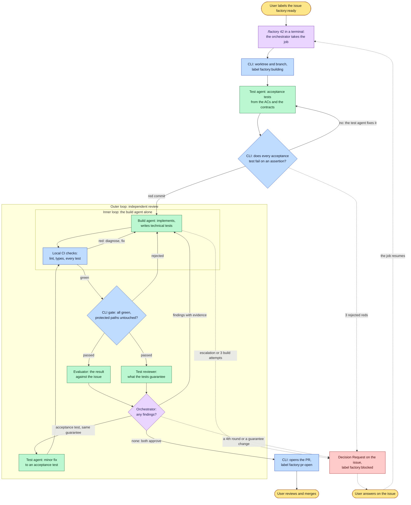
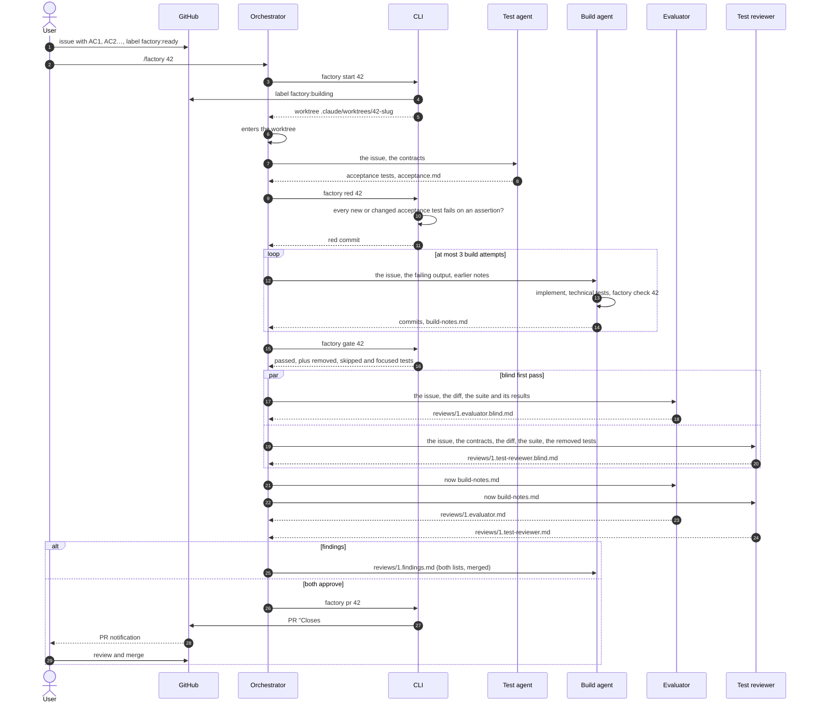
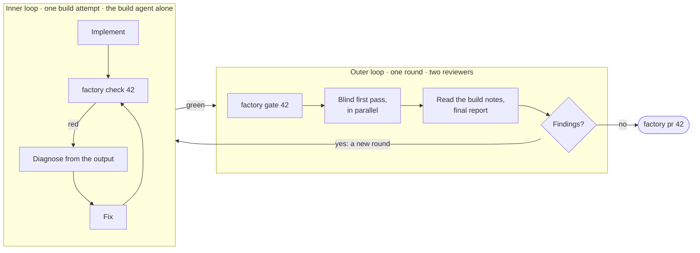
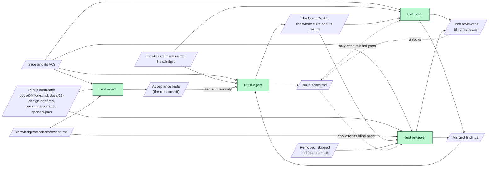
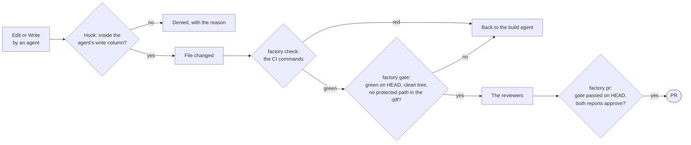
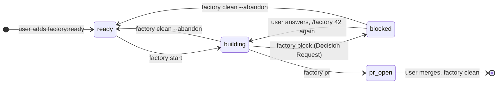
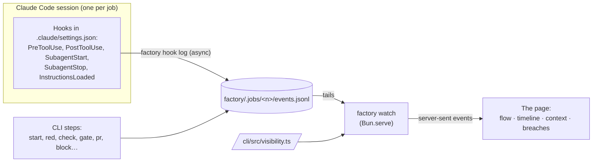

# The Wandr factory

The factory takes a GitHub issue to an open pull request with agents. It **delegates execution, not authority**: agents write the tests and the code, deterministic checks they can't change give the verdict, and the user approves what is built and merges it.

This is version 1.2. How it got here and what comes next: [`versions/`](versions/).

## The flow



Yellow is the user, purple the orchestrator (the `/factory` skill), blue the CLI's deterministic steps, green the agents, each in its own context, and red a job waiting for the user. Solid lines are the path to a PR; dotted lines leave it.

## Who does what

| Actor | What it is | Model | Decides |
| --- | --- | --- | --- |
| **User** | You | — | The issue and its ACs, every Decision Request, any change to an acceptance guarantee, any exception to a gate, the merge |
| **Orchestrator** | The `/factory` skill, in the main session of one terminal | Opus | Which station runs next, merging the two reviewers' findings, diagnosing a second failed build, when to raise a Decision Request |
| **CLI** | `factory/cli`, TypeScript on Bun | — | Nothing: it runs every deterministic step and refuses what breaks a rule |
| **Test agent** | `.claude/agents/factory-test.md` | Sonnet | How to test each AC through the public contracts |
| **Build agent** | `.claude/agents/factory-build.md` | Sonnet | How to implement, and which technical tests earn a place |
| **Evaluator** | `.claude/agents/factory-evaluator.md` | Opus | Whether the result meets the issue's intent and the architecture |
| **Test reviewer** | `.claude/agents/factory-test-reviewer.md` | Opus | Whether the tests guarantee what matters |

Agents that need to map code first hand the search to a Haiku `Explore` subagent; its reads count as the reads of the agent that launched it.

### One job, step by step

Where each step runs and where information moves. Agents never talk to each other: they hand work over through files in the job's folder and commits on the job's branch.



## The two loops



**Build attempts.** A job has one budget of 3 build attempts, shared by both loops. A **build attempt** is one run of the build agent until it stops, and it counts when:

- it is the first run, after the red commit;
- it reruns after a red `factory check`, or after a rejected `factory gate`;
- it reruns because a review round's fix run did not reach green.

A review round's fix run that reaches green costs nothing. Past 3 the job blocks with a Decision Request: `factory attempt` refuses the 4th.

**Inner loop.** The build agent implements, runs the checks, diagnoses and fixes, red–green–refactor where it pays, until `factory check` is green or it stops.

| Attempt | Who runs it | With |
| --- | --- | --- |
| 1 | Build agent (Sonnet), fresh context | The issue and the red commit |
| 2 | Build agent (Sonnet), fresh context | The failing output and attempt 1's notes |
| — | The orchestrator diagnoses (Opus) | The failing test, the diff, both attempts' notes. A technical cause goes to attempt 3; a functional ambiguity goes straight to a Decision Request |
| 3 | Build agent (Sonnet), fresh context | The orchestrator's diagnosis |
| 4 | — | The job blocks with a Decision Request |

**Outer loop.** A **round** is: both reviewers report findings, the fixes are made, both review again. Up to 3 rounds with findings; a fourth blocks the job. The build agent's fix run follows the attempt rules above. Every finding carries its evidence: the command, its output, `file:line`.

A finding about an acceptance test goes one of two ways:

- **Same guarantee** (a wrong selector, a typo): the test agent fixes it, `factory atfix 42` checks that only acceptance tests changed and commits, and the PR lists the fix. When the acceptance-test fixes are the round's only findings, they still count as a round (`factory round 42`), but no build attempt.
- **A different guarantee**: the job raises a Decision Request. Once the user authorizes the change on the issue, the test agent rewrites the test and `factory rewrite 42 --note <the authorization>` commits it. The PR lists it apart, under "Authorized guarantee changes".

## Who sees what

Each agent runs as a fresh subagent. It is independent because of what it receives and what it may change, not because its prompt asks it to be.



| Agent         | Receives                                                                                                                                                                                      | Starts without                                                                                      | May write                                                                                      |
| ------------- | --------------------------------------------------------------------------------------------------------------------------------------------------------------------------------------------- | --------------------------------------------------------------------------------------------------- | ---------------------------------------------------------------------------------------------- |
| Test agent    | The issue and its ACs, the public contracts, `knowledge/standards/testing.md`, the test infrastructure                                                                                        | Any implementation plan: it runs before the build agent                                             | Acceptance tests and their scaffolding, anywhere outside the rule files below; `acceptance.md` |
| Build agent   | The issue, `docs/05-architecture.md`, the repo and `knowledge/`, the acceptance tests (read and run only), the check results, the reviewers' findings                                         | The test agent's reasoning                                                                          | Anything outside the protected paths; `build-notes.md`                                         |
| Evaluator     | The issue and its ACs, `docs/05-architecture.md` and `knowledge/`, the diff against `main`, the whole suite and its results                                                                   | The build notes, until its blind first pass is written                                              | Its own reports in the job's folder                                                            |
| Test reviewer | The issue and its ACs, the public contracts, `knowledge/standards/testing.md`, the diff against `main`, the whole suite and its results, the CLI's list of removed, skipped and focused tests | The build notes, including each technical test's value check, until its blind first pass is written | Its own reports in the job's folder                                                            |

Inputs and the moment each becomes visible are declared once, as data, in [`cli/src/visibility.ts`](cli/src/visibility.ts). The write column is enforced; the read columns are watched:

- **Writes are blocked.** A synchronous `PreToolUse` hook denies an `Edit` or `Write` outside the agent's column and tells it why. A `Bash` command can get past it, so the CLI gate stays the final verdict.
- **Reads are flagged.** `factory watch` marks in red a read outside an agent's inputs, or before they become visible to it. The log keeps the breach; V1 doesn't block it.

## Two kinds of tests

| | Acceptance tests | Technical tests |
| --- | --- | --- |
| Question | Did we build the right thing? | Did we build it right? |
| Source of truth | The issue's ACs and the public contracts | Technical contracts, invariants and implementation risks |
| Named | `*.acceptance.test.ts(x)`; every test in `apps/web/e2e/` | `*.test.ts(x)` |
| Author | Test agent, before implementation, in the red commit | Build agent, during implementation |
| Who changes them | The test agent: with the user's authorization when the guarantee changes, on a reviewer's finding when it doesn't | The build agent, as long as no existing guarantee weakens |
| Defended by | The verified red, then green at the end | The value check, then the test reviewer |

The name keeps an acceptance test protected after its job, so no later build agent can weaken a guarantee the user approved. Both kinds follow [`knowledge/standards/testing.md`](../knowledge/standards/testing.md): the value check and "guarantees, not test count" bind every test.

### A valid red

`factory red` runs every new or changed acceptance test and accepts the red only if each file passes lint and format (`oxlint --deny-warnings` and `oxfmt --check`, the worktree's own, as CI runs them), loaded, ran at least one test, and every test fails on an assertion. A file CI would reject is no red to build on: the build agent can't fix it, so it would cost an acceptance-test fix later. One rejection names every problem at once, lint, format and the run, each with its file and the command that fixes or checks it. Vitest and Playwright run with our own reporters (`factory/cli/src/reporters/`), which write one JSON report in a common shape; `bun test` has no custom-reporter API, so the CLI converts its JUnit report into that shape. The rule then works on one shape:

| Runner | Accepted | Rejected |
| --- | --- | --- |
| `bun test` (JUnit, converted) | `type="AssertionError"` | A file missing from the report (a load error) |
| Vitest (own reporter) | An error named `AssertionError` | A load error on the file's module |
| Playwright (own reporter) | A failed step of the `expect` category | A load error, a file with no test in the run, a timeout |

In every runner, a thrown error, a timeout, a load error, a skipped test, a passing test and a file with no test also reject the red.

Any other error rejects the red and the test agent fixes it. `factory red` records each rejection: after 3 rejected reds the job raises a Decision Request and `red` refuses a 4th. So scaffolding is stubs with the right signature that return an empty value and never throw, plus empty routes or screens; an end-to-end test asserts that an element is visible before acting on it.

## The gates



**Protected paths.** `factory gate` rejects a build whose diff since the red commit touches any of these, and the hook denies the build agent writing them. Commits already on `main`, fetched by the gate itself, aren't the job's: a job that merges `main` to pick up a fix doesn't answer for them.

| What | Paths |
| --- | --- |
| Acceptance tests | `**/*.acceptance.test.ts`, `**/*.acceptance.test.tsx`, `apps/web/e2e/**` |
| CI | `.github/workflows/**` |
| Lint and format | `.oxlintrc.json`, `.oxfmtrc.json`, `packages/oxlint-plugin-wandr/**` |
| TypeScript | `packages/tsconfig/**`, `**/tsconfig*.json` |
| Test runners and the task graph | `apps/web/playwright.config.ts`, `bunfig.toml`, `turbo.json` |
| The rules and the factory | `CLAUDE.md`, `knowledge/**`, `factory/**`, `.claude/**` |

The test agent may write acceptance tests but none of the other rows. `package.json` and `vite.config.ts` aren't protected, because dependencies and plugins change legitimately; the evaluator checks them for tampering. A job that needs to change a protected path escalates with a Decision Request.

**The local checks** are the commands in [`ci.yml`](../.github/workflows/ci.yml), run with `CI=1` in the job's worktree, each step's script handed to `bash --noprofile --norc -eo pipefail -c` as one argument, as GitHub Actions runs it, so its newlines, line continuations and `$VAR`s reach bash untouched: `bun install --frozen-lockfile`, `bun run services`, `bunx turbo run lint typecheck test build`, `bunx oxfmt --check`, the generated-files check, `db:migrate:test` and `bunx turbo run e2e`. Every job shares the same test database, bucket and Playwright port, so a machine-wide lock lets one job run checks at a time; the others wait in line. They share one Docker stack too: `docker-compose.yml` names its project `wandr`, so `bun run services` from any checkout or worktree reuses the same containers and volumes instead of starting a stack that fights over ports 5432 and 9000. Its config holds no host path, so starting it from another checkout doesn't recreate a container. `factory red` takes the same lock.

## A job's states



| State | Label on the issue | Set by |
| --- | --- | --- |
| ready | `factory:ready` | The user |
| building | `factory:building` | `factory start` |
| blocked | `factory:blocked` | `factory block` |
| pr_open | `factory:pr-open` | `factory pr` |

**Abandoning a job.** A job that shouldn't go on, because the factory itself needs a fix or the issue needs rewriting, is discarded with `factory clean <n> --abandon`, in this order: it records `job.abandoned` in the job's log (the last event `factory watch` shows), takes down any compose stack the worktree started on its own, with its volumes but never the shared `wandr` stack, removes the worktree, deletes the branch locally and on `origin`, deletes the job's state folder, and moves the issue's label back to `factory:ready`, as it was before `factory start`. `/factory <n>` then starts the issue from scratch. It refuses while the branch has an open PR, which you close by hand first, and when the PR merged, which is plain `clean`.

**Decision Requests.** Whenever a job needs the user (an escalation or a block), `factory block` comments on the issue with the context, the evidence, the alternatives, a recommendation, the impact and the risks, and moves the label to `factory:blocked`. The answer on the issue is the decision's record. The build agent escalates instead of deciding when a change would touch a public contract, the architecture, an acceptance test or anything outside the issue's ACs.

**Knowing a job ended.** An open PR and a Decision Request reach you as GitHub notifications; the label shows where the job stands; the orchestrator ends with a line in its terminal; `factory watch` shows it live.

## Commands

### In Claude Code

| Command | What it does |
| --- | --- |
| `/factory 42` | Runs the job for issue 42 in this session, from intake to an open PR or a Decision Request. Running it again on a blocked job resumes it. Up to 3 jobs at a time, one terminal each. |

### The CLI

Run from the repo root as `bun run factory <command>`. The orchestrator runs every command except `watch` and `clean`; you can run any of them.

| Command | What it does | Refuses when |
| --- | --- | --- |
| `start <n> --session <id>` | Creates `.claude/worktrees/<n>-<slug>` on `feat/<n>-<slug>`, installs, writes the job's state (`job.json`) in the main checkout and `issue.md` in the job's folder, moves the label to `factory:building`, and prints the job with its folder's path. On an existing job, copies into the job's folder any handoff file that exists only in the main checkout; on a blocked job, moves the label back and prints the user's answer. | The issue lacks `factory:ready` or numbered ACs; 3 jobs already run |
| `red <n>` | Checks lint and format on the new or changed acceptance tests, runs them, and commits them as the red commit | A file fails lint or format; a test passes, or fails on anything but an assertion; 3 reds were already rejected |
| `check <n>` | Runs the CI commands under the lock and saves the output in the job's folder | — (exits non-zero on red) |
| `attempt <n>` | Records a build attempt (see "The two loops" for which runs count) | It would be the 4th |
| `gate <n>` | Checks the last `check` was green on `HEAD`, the tree is clean and no protected path changed; writes the list of removed, skipped and focused tests | Any of those fails |
| `round <n>` | Records a new outer-loop round with findings, acceptance-test fixes included | It would be the 4th |
| `atfix <n> --note <text>` | Commits a same-guarantee fix to an acceptance test and records it for the PR | Anything but acceptance tests changed, or no note |
| `rewrite <n> --note <text>` | Commits the test agent's rewrite of acceptance tests after the user authorized a change of guarantee on the issue; the note cites the authorization (the issue comment's URL) and the PR lists it | The job has no Decision Request, anything but acceptance tests changed, or no note |
| `block <n> <file>` | Posts the Decision Request in `<file>` on the issue, label `factory:blocked` | — |
| `pr <n>` | Pushes the branch, opens the PR, posts the build notes and both final reports as a comment, label `factory:pr-open` | The gate didn't pass on `HEAD`, or a final report doesn't approve |
| `status` | Lists the jobs and where each stands | — |
| `watch` | Serves the live page on `localhost` | — |
| `clean <n>` | Removes a merged job's worktree, branch and folder | The PR isn't merged |
| `clean <n> --abandon` | Discards a job that won't merge, so its issue can start again: records the event, takes down the worktree's own compose stack, removes the worktree and the branch (local and remote), deletes the job's folder, moves the label back to `factory:ready` | The branch has an open PR (close it first) or a merged one |
| `hook log` · `hook guard` | Entry points for Claude Code's hooks; not run by hand | — |

**The pull request** is titled after the issue and its body holds `Closes #<n>`, a summary of the change, each AC with the acceptance tests that check it (from `acceptance.md`), the result of the local checks, any same-guarantee fixes to acceptance tests, and, in a separate section, any authorized guarantee changes with the note that cites each authorization. The comment beside it holds the build notes and both reviewers' final reports, so they stay on record in GitHub.

## Watching a job

`bun run factory watch` serves one page that shows every running job live, with no reload. Its purpose is to make the factory checkable: to spot an agent doing something you don't want, reading more than it should, or seeing work it should be blind to.



**The event log.** Every job appends to `factory/.jobs/<n>/events.jsonl` in the main checkout, written only by the CLI and by Claude Code hooks, never by an agent: the main checkout is outside the worktree agents are confined to, and `factory/` and `.claude/` are protected paths inside it.

- Hooks are declared in `.claude/settings.json`, because they fire inside every subagent; hooks in a skill's frontmatter don't. Each logging hook is `async`, so it never slows an agent down.
- A hook finds its job by the session: `factory start` records the session's ID, and every event in that session, its subagents' included, carries it. Outside a job the hooks do nothing.
- Each event records its time, job, source, agent run (`agent_id`, `agent_type`), kind, and for a file the path, the lines read and an approximate size in tokens. The log keeps paths and sizes, never file contents: the subagents' transcripts hold those.
- The orchestrator's `Agent` call carries each agent's prompt, the context it starts with; its result carries the new agent's ID, which ties the prompt to the run.
- `InstructionsLoaded` shows each `CLAUDE.md` an agent loads.
- Files a `Bash` command changes are attributed from git: when an agent stops, the hook records what changed in the worktree during its run. Only one agent writes at a time, so the attribution is exact.

**The page** is one HTML file with inline CSS, SVG and JavaScript and no build step; `factory watch` also serves `cli/src/watch/state.ts`, the event-to-state logic the page shares with its tests. It shows:

- **The flow**: the stations of the diagram above, each lit as it runs, failed in red when a check, the gate or a red is rejected, and the edges of the latest move animated. Violet brackets mark where the orchestrator is, with a tag saying what it is doing; they sit on the station it waits on (the build agent while the checks it triggers run, both reviewers together, the Decision Request when blocked) and glide as the job moves. When an agent reads a file another actor wrote, a comet travels from one station to the other.
- **The live feed**: every event, newest first.
- **The timeline**: the orchestrator's lane, coloured by where its brackets were (deciding, running a CLI step, waiting on an agent, waiting on you); the CLI steps; and one lane per agent run (each build attempt is its own run, nested runs indented) for the job selected, so overlapping bars show what runs in parallel.
- **Each agent's context**: pick a run, or follow the live one: the prompt it received, the instructions it loaded, every file it read with its lines and size, every file it changed, every write denied.
- **Isolation breaches, in red**, against `visibility.ts`.

A finished job replays from its log at any speed: `bun run factory watch`, then open `/?job=<n>&speed=<x>`; quiet stretches are skipped so the replay keeps moving.

## Where things live

```
.github/ISSUE_TEMPLATE/factory.yml   the issue form: description and numbered ACs
.claude/
  settings.json                      the hooks
  skills/factory/SKILL.md            the orchestrator
  agents/factory-*.md                the four agents
  worktrees/<n>-<slug>/              the job's worktree, on feat/<n>-<slug>
    factory/.jobs/<n>/               gitignored: the job's folder, what agents hand each other
      issue.md                       the issue and its ACs, written by factory start
      acceptance.md                  the test agent's map of each AC to its tests
      build-notes.md                 decisions and each technical test's value check
      checks/                        the output of every factory check
      gate.json                      the gate's verdict and its removed, skipped and focused tests
      reviews/                       blind passes, final reports, merged findings, per round
      diagnosis.md                   the orchestrator's diagnosis before a third build attempt
      summary.md                     the orchestrator's summary for the PR
      decision-requests/             each Decision Request, its draft and as posted
factory/
  README.md                          this file
  cli/                               the CLI, a Bun workspace, tested with bun test
  versions/                          one file per version: v1.md…
  .jobs/                             gitignored: the jobs' state, in the main checkout
    checks.lock                      the machine-wide lock on the local checks
    <n>/
      job.json                       state: session, branch, red commit, attempts, rounds, rejected reds, gate
      events.jsonl                   the event log
      install.log, red/, runs/       the CLI's own logs and the hooks' per-run snapshots
      pr-body.md, pr-comment.md      what factory pr posted
```

A job's files live in two places, and the split follows who writes them:

- **The job's folder, in its worktree.** The orchestrator enters the worktree after `factory start`, and from then on Claude Code confines the session and every subagent to it: a `Write` or `Edit` outside it is refused. So everything agents and the orchestrator hand each other lives there, at `<worktree>/factory/.jobs/<n>/`. The guard hook and `factory watch` place that folder in the `job` area of [`cli/src/visibility.ts`](cli/src/visibility.ts), not in the protected `factory/**` of the repo; the rest of `factory/` in the worktree stays protected.
- **The job's state, in the main checkout.** `job.json` and `events.jsonl` are written only by the CLI and the hooks, which aren't confined. Keeping them in the main checkout puts them outside every agent's reach, lets `factory status` and the 3-job limit read every job in one place, and keeps the job's record when its worktree is removed. To agents the main checkout, its copy of `factory/.jobs/<n>/` included, is `outside`.

No symlink joins the two: auto mode blocks them because they sidestep its oversight, and a path through one would resolve to a different area than it reads as.
