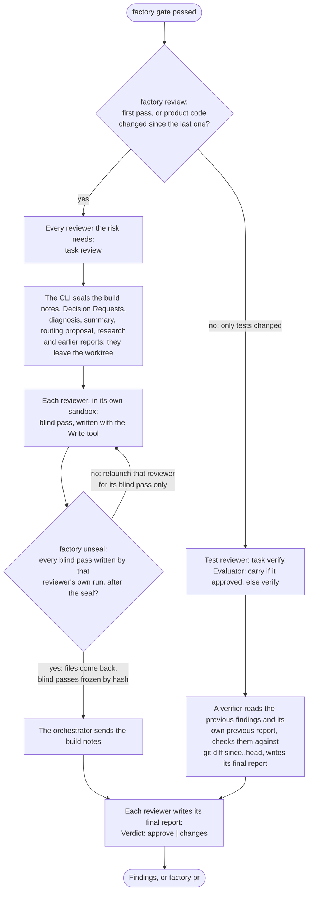

# Isolation

Each agent runs as a fresh subagent. It is independent because of what it receives and what it may change, not because its prompt asks it to be. This doc covers how that is enforced: what each agent sees, the seal that keeps the reviewers blind, the guard that judges every tool call, and the sandboxes that keep the two reviewers apart.

## Who sees what

Each agent's inputs, and the moment each becomes visible, are declared once, as data, in [`cli/src/visibility.ts`](../cli/src/visibility.ts). The table holds what that file can't say: why each agent starts without something.

| Agent | Starts without | May write |
| --- | --- | --- |
| Test agent | Any implementation plan: it runs before the build agent, so its tests define done instead of describing a build | Acceptance tests and their scaffolding, anywhere outside the rule paths; `acceptance.md` |
| Build agent | The test agent's reasoning | Anything outside the protected paths; `build-notes.md` |
| Evaluator | The build notes, Decision Requests, diagnosis, summary, routing proposal, research, the other reviewer's reports and its own earlier final reports, until its blind first pass is written: each repeats or cites the build agent's reasoning | Its own reports in the job's folder; its own sandbox |
| Test reviewer | The same sealed material, including each technical test's value check | Its own reports and rulings in the job's folder; its own sandbox |
| Diagnosis agent | Nothing: it has no blind pass | `diagnosis.md` |

Three layers apply the declaration:

- **The seal** takes the sealed material out of the worktree, so no command can read it there.
- **The guard** denies the same names as a second layer, and the channels around them.
- **`factory watch`** classifies every read (`Bash`, `Grep` and `Glob` paths included) and marks in red a read outside an agent's inputs or before they became visible, and every denial. Replaying job #13's log flags the four early reads its blind passes made ([`cli/src/replay-fixtures/`](../cli/src/replay-fixtures/)).

## A review pass and the seal

A pass is sized to what changed since the last reviewed `HEAD`. `factory review` plans it, seals what the blind reviewers mustn't see, and prints the plan: the pass number, each reviewer's task, and the paths a verifier reads.

- **Tasks.** `review` is a full blind review, then a final report. `verify` has no blind pass: it checks the previous findings against the diff since the last pass. `carry` is no run: the evaluator's earlier approval stands because only tests changed.
- **While sealed**, the build agent's reasoning sits in the main checkout, outside every agent's reach, and the job's other commands refuse. `review` calls `seal` itself.
- **The unseal proves authorship.** It waits until each sealed role's blind pass is non-empty and the event log shows that role's own agent wrote it with the Write tool, in a run launched after the seal. It also waits for a verifier's final report, since a verifier reads from the sealed store. A seal stuck on a missing blind pass has no override: the reviewer is relaunched, never messaged, because a message to a run launched before the seal could carry sealed context.
- **Frozen.** `unseal` records each blind pass's hash and `factory pr` checks it, so a blind pass can't change after the notes are in.
- **Verifiers' reads.** While another reviewer's blind pass keeps the job sealed, a verifier reads only the previous merged findings and its own earlier final reports, from the sealed store. The notes, Decision Requests and the other reviewer's reports stay closed to it until its final report is written.
- **Blind passes stay independent.** No run reads the other reviewer's `reviews/<k>.<role>.blind.md` until its own for that pass is written.

## The guard

A synchronous `PreToolUse` hook, `factory hook guard`, judges every tool call a job makes: its matcher is `*`, not only `Edit` and `Write`. One policy module per tool family ([`bash-policy.ts`](../cli/src/bash-policy.ts), [`write-guard.ts`](../cli/src/write-guard.ts), [`read-guard.ts`](../cli/src/read-guard.ts), agent prompts in [`commands/hook.ts`](../cli/src/commands/hook.ts)) gives a verdict from the call and the job alone; the hook only logs it.

**Fail closed.** Inside a job, a call the guard can't judge, for any error, is denied, and the error goes to the hook-errors log. Outside a job the hook does nothing. Every path is judged where it leads: symlinks are resolved first, `..` after a link included.

**Why the user's commands are the user's.** `factory answer` checks nothing about its caller. A command the user types with `!` fires no `PreToolUse` hook; a model's Bash call does, with the same environment and no TTY. So the guard's denial of `answer`, `clean` and `watch` to every tool call, the orchestrator's included, is what makes them the user's.

| To | Denied |
| --- | --- |
| Everyone, the orchestrator included | `factory answer`, `hook`, `watch` and `clean`; `gh` writes, HTTP to GitHub and `git push` (the CLI pushes and posts); `git credential`; `git notes` writes and a `git config` of an alias, a hooks path or an fsmonitor; `claude`; writing the job's state in the main checkout; `factory start` with another session's ID (it would rebind the job and switch its guard off); a command whose factory subcommand or `gh` call the guard can't read from its text (`xargs`, a `$VAR`, `bun -e` loading the CLI, a shell fed its code on stdin) |
| The orchestrator | Every MCP tool and any tool outside a short list during a job; a prompt or message that names or quotes sealed material while the job is sealed; writing a reviewer's files (`reviews/<k>.evaluator*`, `reviews/<k>.test-reviewer*`, `rulings/**`) |
| Every subagent | Any tool the guard has no policy for; the main checkout outside the job's worktree and Claude Code's own files (`~/.claude`, transcripts, task outputs); all `gh`; any factory command but its own (build and test agents: `check` and `status`; reviewers: `status` and `sandbox` for their own role); writes outside its column above; any `git config` write, `git update-ref`, `git notes` write, `git tag`, `git branch -f` and `-d`; a merge |
| The build, test and diagnose agents | `git reset --hard` to anything but `HEAD`, `git rebase --onto` and `git commit --amend` of a commit the CLI made (each could drop it, and the gate refuses a branch without it); a walk rooted in `factory/.jobs/` once the reviewers' sandboxes exist |
| A reviewer | The other reviewer's sandbox, and every walk or glob that reaches it (`rg` and `grep` from the worktree root skip the gitignored job folder and stay allowed); the sealed names until its own blind pass is written; anything outside `factory sandbox exec` that isn't read-only; git that moves a repository outside its own sandbox |

**A reviewer runs an allowlist, not a denylist of runners.** Outside `sandbox exec` it runs read-only programs only (the list is in [`bash-policy.ts`](../cli/src/bash-policy.ts)); `bun`, `node`, `curl`, `psql`, a script and every other runner go through `factory sandbox exec <n> <role> -- <command>`. There the guard judges only the command after `--`, from the reviewer's own sandbox, so `git reset --hard`, `git stash` and `git clean -fd` are the reviewer's to run there.

**While a verifier is pending**, no subagent reads the sealed names, the verifier's own inputs aside: a nested run under it can't be told apart from a stranger.

**Protected writes in Bash** (redirections, `tee`, `cp`, `mv`, `sed -i`, `rm`, `git rm`, `git checkout <rev> -- <paths>`, an archive extracted onto a folder that holds a protected path, and the rest in [`bash-policy.ts`](../cli/src/bash-policy.ts)) are judged as an Edit's. Left to the gate, which sees every commit: a patch's own targets (`patch -p1 < p`, `git apply`, `git am`), `git stash pop` and `git cherry-pick`, `xargs rm < list`, acceptance tests beside their code under a copied folder, a script written then run.

### Known limits

- **Reviewers share the services by name only.** The other reviewer's database and bucket are denied by name in a command; both sit in one Postgres and one MinIO, and the guard can't stop a reviewer reaching them another way, or a `kill` inside `sandbox exec` reaching the other's processes. A role-scoped database user is the fix.
- **The guard is keyed on the session ID.** `factory start --session` binds the job to a session, and before that call the new session's tool calls are unguarded. Only the skill's step order covers it: `start` is the first command of a run.

### Threat model

The guard stops a hurried or careless agent, and any plain command or tool call. It reads command text, and a shell is open-ended, so a deliberately built command can get past it. Launchers (`env`, `nice`, `sh -c`…), interpreter operands and git's own spellings are judged, but each adversarial review round found spellings the one before missed: a text-parsing Bash guard can't be complete.

**Accepted residual:** a script written then run; code built at runtime (base64, `eval`, string concatenation); an interpreter's own file operations beyond what the guard recognizes; the commit subject; code comments. OS-level sandboxing of Bash is the planned fix for that class. Until then the CLI's gate, `unseal`, `atfix` and `pr` don't trust the guard alone: they check the event log for who wrote what, and the commit history for what the gate forbids.

## The reviewers' sandboxes

Two reviewers sharing one port, one `apps/web/dist` and one database would see each other's mutations. So each reviewer runs everything in its own sandbox: `factory sandbox <n> <role>` makes a disposable detached checkout of the job's `HEAD` under `<job>/sandbox/<role>/`, with its own dependencies, port, database and bucket. `sandbox exec` runs a command there with `PORT`, `E2E_PORT`, `DATABASE_URL` and `S3_BUCKET` set; Playwright reads `E2E_PORT` and never reuses a server when it is set. Removing a sandbox, by `sandbox rm` or by `clean`, needs the services up (`bun run services`) to drop its database and bucket.
