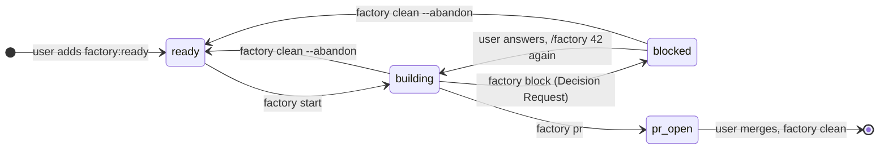

# Operating

How to run and follow a job: its states, what the PR carries, what each agent cost, the live page, and where every file lives. The commands and what each refuses: `bun run factory`.

## A job's states



Each state is the issue's label: `factory:ready` (set by the user), `factory:building`, `factory:blocked` and `factory:pr-open`. Up to 3 jobs run at a time, one terminal each; `/factory <n>` on a blocked, answered job resumes it.

**The user's commands.** `answer`, `clean` (either form) and `watch` run only from the user's own prompt, `! bun run factory <command>`.

**Abandoning a job** that shouldn't go on, because the factory needs a fix or the issue needs rewriting, is `factory clean <n> --abandon`. In order: it records `job.abandoned` in the log (the last event `factory watch` shows), takes down any compose stack the worktree started on its own (never the shared `wandr` stack), removes the sandboxes and the worktree, deletes the branch locally and on `origin`, deletes the job's state, and moves the label back to `factory:ready`. It refuses while the branch has an open PR, which you close by hand, and when the PR merged, which is plain `clean`.

**Knowing a job ended.** An open PR reaches you as a GitHub notification; a Decision Request appears in the orchestrator's terminal; the label shows where the job stands; `factory watch` shows it live.

## The pull request

Titled after the issue, its body holds `Closes #<n>`, a summary of the change, each AC with the acceptance tests that check it (from `acceptance.md`), the result of the local checks, any same-guarantee fixes to acceptance tests, and, apart, any authorized guarantee changes with the note that cites each. A comment beside it opens with the cost per agent, then holds the build notes and the final reports, so they stay on record in GitHub.

## Cost per agent

The `SubagentStop` and `Stop` hooks read each run's transcript, deduplicate by message ID, and log one `usage` event per run: tokens by kind (5-minute and 1-hour cache writes priced apart), the models and efforts seen, and the cost from the dated price table in [`cli/src/prices.ts`](../cli/src/prices.ts). A model the table doesn't price is listed as unpriced, not guessed.

## Watching a job

`bun run factory watch` serves one page that shows every running job live, with no reload. Its purpose is to make the factory checkable: to spot an agent doing something you don't want, reading more than it should, or seeing work it should be blind to.

**The event log.** Every job appends to `factory/.jobs/<n>/events.jsonl` in the main checkout, written only by the CLI and the hooks, never by an agent: the main checkout is outside the worktree agents are confined to.

- Hooks are declared in `.claude/settings.json`, because they fire inside every subagent; hooks in a skill's frontmatter don't. Each logging hook is `async`, so it never slows an agent down.
- A hook finds its job by the session: `factory start` records the session's ID, and every event in that session, its subagents' included, carries it. Outside a job the hooks do nothing.
- An event records its time, job, source, agent run, kind, and for a file the path, the lines read and an approximate size in tokens; never file contents, which the transcripts hold.
- The orchestrator's `Agent` call carries each agent's prompt, and its result the new agent's ID, which ties the prompt to the run. `InstructionsLoaded` shows each `CLAUDE.md` an agent loads.
- Files a `Bash` command changes are attributed from git: when an agent stops, the hook records what changed in the worktree during its run. Only one agent writes at a time, so the attribution is exact.

**The token.** The page shows everything, the sealed names and the user's answers included. So `watch` makes a random token at start, keeps it in the main checkout's state folder (`watch-token`, mode 0600), and prints a URL that carries it. Every route answers only a request with that token; an agent that reaches the port gets nothing. A restart makes a new token.

**The page** is one HTML file with inline CSS, SVG and JavaScript and no build step; `watch` also serves [`cli/src/watch/state.ts`](../cli/src/watch/state.ts), the event-to-state logic the page shares with its tests. It shows the flow of the [overview diagram](../README.md#the-flow), each station lit as it runs and failed in red when rejected, with brackets marking where the orchestrator is; a live feed; a timeline with one lane per agent run; each run's context (its prompt, instructions, reads, writes and denials); the risk and what raised it, each pass's review plan, the seal, the rulings, and any model or effort that drifts from what `launch` planned (the guard denies a launch or an orchestrator that drifts, so this shows runs that bypassed a launch, such as a subagent's own); each run's cost and the job's total; and, in red, isolation breaches against `visibility.ts` and every denial.

A finished job replays from its log: add `&job=<n>&speed=<x>` to the URL `watch` printed; quiet stretches are skipped.

## Where things live

```
.github/ISSUE_TEMPLATE/factory.yml   the issue form: description, Risk and numbered ACs
.claude/
  settings.json                      the hooks
  skills/factory/SKILL.md            the orchestrator
  agents/factory-*.md                the five agents
  worktrees/<n>-<slug>/              the job's worktree, on feat/<n>-<slug>
    factory/.jobs/<n>/               gitignored: the job's folder, what agents hand each other
      issue.md                       the issue and its ACs, written by factory start
      routing-proposal.json          the orchestrator's classification (sealed during blind review)
      research.md                    read-only investigation findings (sealed during blind review)
      acceptance.md                  the test agent's map of each AC clause to its assertion
      build-notes.md                 decisions and each technical test's value check
      checks/                        the output of every factory check
      gate.json                      the gate's verdict and its removed, skipped and focused tests
      reviews/                       blind passes, final reports, merged findings, per pass
      rulings/                       the test reviewer's rulings on acceptance-test fixes
      sandbox/<role>/                a reviewer's disposable checkout
      diagnosis.md                   the diagnosis agent's report before a third build attempt
      summary.md                     the orchestrator's summary for the PR
      decision-requests/             each Decision Request, its draft and as kept
factory/
  README.md, docs/                   these docs
  cli/                               the CLI, a Bun workspace, tested with bun test
  versions/                          one record per version
  .jobs/                             gitignored: the jobs' state, in the main checkout
    checks.lock                      the machine-wide lock on the local checks
    watch-token, hook-errors.log     the live page's token, and what the hooks failed on
    <n>/
      job.json                       state: session, branch, risk, route, red commit, attempts, rounds, reviews, rulings, answers, blind-pass hashes
      events.jsonl                   the event log
      seal.json, sealed/             the seal's record and the files it moved, while sealed
      sandbox/                       each sandbox's record (port, database, bucket) and log
      install.log, red/, runs/       the CLI's own logs and the hooks' per-run snapshots
      pr-body.md, pr-comment.md      what factory pr posted
```

A job's files live in two places, and the split follows who writes them:

- **The job's folder, in its worktree.** After `factory start` the orchestrator enters the worktree, and from then on Claude Code confines the session and every subagent to it: a `Write` or `Edit` outside it is refused. So everything agents hand each other lives at `<worktree>/factory/.jobs/<n>/`. The guard and `factory watch` place that folder in the `job` area of [`visibility.ts`](../cli/src/visibility.ts), not in the protected `factory/**`.
- **The job's state, in the main checkout.** `job.json`, `events.jsonl`, the seal and the sandboxes' records are written only by the CLI and the hooks, which aren't confined. That puts them outside every agent's reach, lets `status` and the 3-job limit read every job in one place, and keeps the record when the worktree is removed. To agents the main checkout is `outside`.

No symlink joins the two: auto mode blocks them because they sidestep its oversight, and a path through one would resolve to a different area than it reads as.
